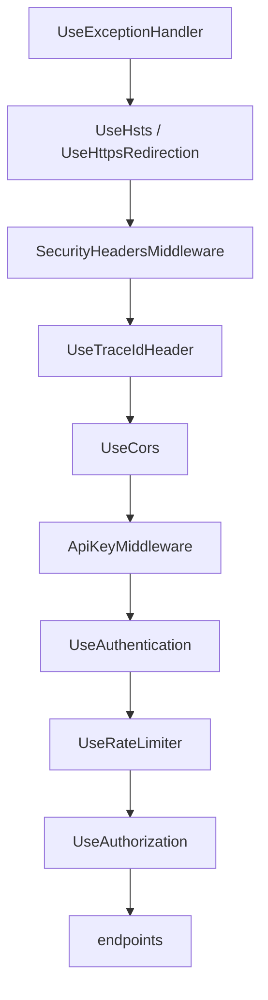

# Lesson 13 — Security Hardening: Ready for the Outside World

Good day, developer! Our app works, and we can see what it's doing. But so far it has only ever met friendly
callers on your own machine. Out on a real network, it will meet password guessers, browsers that can be
tricked, and, one day maybe, a bug that lets someone run a query they shouldn't. Today we add the locks.
Each one is small; together they're what separates a demo from a product. About two hours. Are you ready?
Let's begin!

## What we'll build

| Protection | Stops |
|---|---|
| **Rate limiting** | One caller flooding the API, and password guessing across many accounts |
| **HTTPS redirection and HSTS** | Passwords and tokens travelling in plain text |
| **Security headers** | Browsers being tricked into framing or sniffing our responses |
| **CORS from configuration** | Other websites calling the API from a user's browser |
| **An API key per client app** | Unknown programs calling the API at all |
| **Sign-in keys in the database** | Everyone being signed out whenever the server restarts |
| **A least-privilege database account** | A compromised app dropping or changing your tables |

## Why we build it this way

Security works in layers. No single lock stops everything, and each of these assumes the others might fail.
The account lockout from [lesson 05](05-sign-in.md) protects one account from guessing, but someone trying
one password on a thousand accounts never trips it; a rate limit per IP address does. HTTPS protects tokens
on the wire, but a browser could still be tricked into embedding our pages; security headers stop that. And
if, despite everything, someone finds a way to run SQL through our app, a database account that can't `DROP`
anything limits the damage.

To remember it easily: a good building has a fence, a locked door, and a safe inside. Not one very strong
door.

## 1. Rate limiting

ASP.NET Core has a rate limiter built in. We'll give every caller a generous budget, and the sign-in
endpoints a strict one.

The policy name is shared between the host (which defines it) and the Identity module (which uses it), so it
goes in BuildingBlocks:

```csharp
// src/Shared/Erp.Shared.BuildingBlocks/Abstractions/RateLimitPolicies.cs
namespace Erp.Shared.BuildingBlocks;

public static class RateLimitPolicies
{
    public const string Auth = "auth";
}
```

```csharp
// src/Erp.Api/Security/RateLimiting.cs
using System.Security.Claims;
using System.Threading.RateLimiting;
using Erp.Shared.BuildingBlocks;
using Microsoft.AspNetCore.RateLimiting;

namespace Erp.Api.Security;

internal static class RateLimiting
{
    public static IServiceCollection AddErpRateLimiting(this IServiceCollection services, IConfiguration config)
    {
        var limits = config.GetSection("RateLimiting");
        var perClient = limits.GetValue("RequestsPerMinute", 300);
        var auth = limits.GetValue("AuthRequestsPerMinute", 10);

        return services.AddRateLimiter(o =>
        {
            o.RejectionStatusCode = StatusCodes.Status429TooManyRequests;
            o.OnRejected = (ctx, _) =>
            {
                if (ctx.Lease.TryGetMetadata(MetadataName.RetryAfter, out var retryAfter))
                    ctx.HttpContext.Response.Headers.RetryAfter = ((int)retryAfter.TotalSeconds).ToString();
                return ValueTask.CompletedTask;
            };

            o.GlobalLimiter = PartitionedRateLimiter.Create<HttpContext, string>(ctx =>
                ctx.Request.Path.StartsWithSegments("/health")
                    ? RateLimitPartition.GetNoLimiter("health")
                    : RateLimitPartition.GetFixedWindowLimiter(ClientKey(ctx), _ => PerMinute(perClient)));

            // Sign-in endpoints: per IP and strict, to slow password guessing (lockout covers a single account).
            o.AddPolicy(RateLimitPolicies.Auth, ctx =>
                RateLimitPartition.GetFixedWindowLimiter($"ip:{ctx.Connection.RemoteIpAddress}", _ => PerMinute(auth)));
        });
    }

    private static string ClientKey(HttpContext ctx) =>
        ctx.User.FindFirstValue(ClaimTypes.NameIdentifier) is { } userId
            ? $"user:{userId}"
            : $"ip:{ctx.Connection.RemoteIpAddress}";

    private static FixedWindowRateLimiterOptions PerMinute(int permits) =>
        new() { PermitLimit = permits, Window = TimeSpan.FromMinutes(1), QueueLimit = 0 };
}
```

Let's read it slowly:

| Piece | Meaning |
|---|---|
| **Partition** | A separate budget per caller. Signed-in callers are counted per *user*; anonymous ones per IP address |
| **Fixed window** | Each minute, the budget starts over: 300 requests by default |
| Health checks | Never limited. A load balancer asking "are you up?" every few seconds shouldn't use up anyone's budget |
| The `auth` policy | 10 per minute per IP, for sign-in. Generous for a person, painful for a script |
| 429 and `Retry-After` | "Too many requests; try again in N seconds", so a polite client knows when to come back |

Register it in `Program.cs` with `builder.Services.AddErpRateLimiting(builder.Configuration);`, and put
`app.UseRateLimiter();` **between** `UseAuthentication()` and `UseAuthorization()`. It has to come after
authentication, or it couldn't tell who the user is, and every signed-in caller would share their IP's budget.

Then apply the strict policy to every sign-in endpoint. In `IdentityModule.MapIdentityModule`, add one line
to the end of the chain:

```csharp
.RequireRateLimiting(RateLimitPolicies.Auth);
```

And the defaults in `appsettings.json`:

```json
"RateLimiting": { "RequestsPerMinute": 300, "AuthRequestsPerMinute": 10 }
```

## 2. HTTPS everywhere

```csharp
// services
builder.Services.AddHsts(o =>
{
    o.MaxAge = TimeSpan.FromDays(365);
    o.IncludeSubDomains = true;
});

// pipeline, right after UseExceptionHandler()
if (!app.Environment.IsDevelopment())
    app.UseHsts();
app.UseHttpsRedirection();
```

`UseHttpsRedirection` answers any plain `http://` request with "go to `https://` instead". **HSTS** goes one
step further: it tells the browser "for the next year, never even *try* plain HTTP on this site". After the
first visit, a password can't leak over HTTP even if someone types `http://`. It's skipped in development,
because a browser would remember it for `localhost` too, and that gets annoying fast.

## 3. Security headers

A few response headers tell browsers to be careful with what we send:

```csharp
// src/Erp.Api/Security/SecurityHeadersMiddleware.cs
namespace Erp.Api.Security;

internal sealed class SecurityHeadersMiddleware(RequestDelegate next)
{
    public Task InvokeAsync(HttpContext ctx)
    {
        var headers = ctx.Response.Headers;
        headers.XContentTypeOptions = "nosniff";
        headers.XFrameOptions = "DENY";
        headers["Referrer-Policy"] = "no-referrer";
        headers["Permissions-Policy"] = "camera=(), microphone=(), geolocation=()";

        // JSON responses never need scripts, styles or frames. Swagger UI (development only) does.
        if (!ctx.Request.Path.StartsWithSegments("/swagger"))
            headers.ContentSecurityPolicy = "default-src 'none'; frame-ancestors 'none'";

        return next(ctx);
    }
}
```

| Header | Tells the browser |
|---|---|
| `X-Content-Type-Options: nosniff` | Trust the declared content type; don't guess, and never run JSON as a script |
| `X-Frame-Options: DENY` | Never show this inside another site's frame (stops "clickjacking") |
| `Referrer-Policy: no-referrer` | Don't tell other sites which of our URLs a link came from |
| `Permissions-Policy` | This app never needs the camera, microphone or location |
| `Content-Security-Policy` | This response may load nothing at all: no scripts, no styles, no frames |

Register it right after `UseHttpsRedirection()`: `app.UseMiddleware<SecurityHeadersMiddleware>();`. And one
more header to *remove*: by default, the web server announces itself with `Server: Kestrel`. That helps an
attacker pick their tools, and helps nobody else. Right after `CreateBuilder`:

```csharp
builder.WebHost.ConfigureKestrel(o => o.AddServerHeader = false);
```

## 4. CORS, from configuration

A browser won't let a web page from one site call an API on another site, unless the API says that site is
allowed. That permission is **CORS**. We list the allowed sites in configuration, so each installation can
set its own:

```csharp
var allowedOrigins = builder.Configuration.GetSection("Cors:AllowedOrigins").Get<string[]>() ?? [];
builder.Services.AddCors(o => o.AddDefaultPolicy(p =>
{
    if (builder.Configuration.GetValue<bool>("Cors:AllowAnyOrigin"))   // development only
        p.AllowAnyOrigin().AllowAnyHeader().AllowAnyMethod();
    else
        p.WithOrigins(allowedOrigins).AllowAnyHeader().AllowAnyMethod();
}));
// pipeline, before the API key and authentication:
app.UseCors();
```

`appsettings.json` allows nobody by default; `appsettings.Development.json` allows anything, because the test
console opens straight from your disk and has no real origin:

```json
"Cors": { "AllowAnyOrigin": false, "AllowedOrigins": [] }
```

```json
"Cors": { "AllowAnyOrigin": true }
```

## 5. An API key per client app

A token says which *user* is calling. An **API key** says which *program* is calling: the web app, the mobile
app, an integration. With one key per program, you can tell them apart in your logs, and if one program's key
leaks, you replace that one key without disturbing the others.

```csharp
// src/Erp.Api/Security/ApiKeyMiddleware.cs
using System.Security.Cryptography;
using System.Text;

namespace Erp.Api.Security;

// Identifies the client APP (not the user) on every request, so one app's key can be revoked on its own.
internal sealed class ApiKeyMiddleware(RequestDelegate next, IConfiguration config)
{
    private const string HeaderName = "X-Api-Key";

    private readonly (string Client, byte[] Key)[] _keys =
        config.GetSection("ApiKeys").Get<Dictionary<string, string>>()
            ?.Where(kv => !string.IsNullOrEmpty(kv.Value))
             .Select(kv => (kv.Key, Encoding.UTF8.GetBytes(kv.Value)))
             .ToArray()
        ?? [];

    public async Task InvokeAsync(HttpContext context)
    {
        // Browsers never send custom headers on a CORS preflight, so OPTIONS must pass.
        if (HttpMethods.IsOptions(context.Request.Method) || IsExempt(context.Request.Path))
        {
            await next(context);
            return;
        }

        context.Request.Headers.TryGetValue(HeaderName, out var provided);
        var client = Match(provided!);
        if (client is null)
        {
            context.Response.StatusCode = StatusCodes.Status401Unauthorized;
            await context.Response.WriteAsJsonAsync(new { error = "Missing or invalid API key." });
            return;
        }

        context.Items["ClientId"] = client;
        await next(context);
    }

    private static bool IsExempt(PathString path) =>
        path.StartsWithSegments("/health") || path.StartsWithSegments("/swagger");

    private string? Match(string provided)
    {
        if (string.IsNullOrEmpty(provided)) return null;
        var bytes = Encoding.UTF8.GetBytes(provided);
        foreach (var (client, key) in _keys)
            if (CryptographicOperations.FixedTimeEquals(bytes, key))   // constant time: no timing leak
                return client;
        return null;
    }
}
```

Two details matter here. **`FixedTimeEquals`** compares the keys in the same amount of time whether they
match on the first character or the last, so an attacker can't guess a key one character at a time by timing
the answers. And **health checks are exempt**, because the thing asking "are you up?" is a load balancer, not
a client app.

Register it after `UseCors()` and before `UseAuthentication()`: `app.UseMiddleware<ApiKeyMiddleware>();`.
Add the keys to configuration: empty in `appsettings.json` (each installation sets its own), and two
development keys in `appsettings.Development.json`:

```json
"ApiKeys": { "web": "", "mobile": "" }
```

```json
"ApiKeys": {
  "web": "SIUgiguVpxcKJ4Ohk5l00kYJXEDPe8rFO8Do59AEloY=",
  "mobile": "EHI6HUaAKe05b8l5dZaT7Geof9vhZnH31id5zL9SjCU="
}
```

Generate real keys with `openssl rand -base64 32`, one per app.

Swagger needs to send the key too. In `AddSwaggerGen`, after the bearer definition:

```csharp
options.AddSecurityDefinition("ApiKey", new OpenApiSecurityScheme
{
    Name = "X-Api-Key", Type = SecuritySchemeType.ApiKey, In = ParameterLocation.Header
});
options.AddSecurityRequirement(doc => new OpenApiSecurityRequirement
{
    { new OpenApiSecuritySchemeReference("ApiKey", doc, null), new List<string>() }
});
```

Now, let's be honest about a limit here. An API key inside a browser app isn't secret: anyone can open the
browser's developer tools and read it. It still lets you tell apps apart and switch one off, but it isn't a
password. The *user's* sign-in is still what protects the data.

## 6. Sign-in keys that survive a restart

Identity encrypts its tokens and cookies with keys that, by default, live in your user profile. On a server,
that breaks two ways: an IIS app pool may not have a profile, so the keys vanish on every restart and
everyone is signed out; and two servers behind a load balancer would each have their own keys, so a token
from one is garbage to the other. The fix is to keep the keys in the database, where every instance can find
them.

```bash
dotnet add src/Modules/Identity/Erp.Modules.Identity package Microsoft.AspNetCore.DataProtection.EntityFrameworkCore --version 10.0.14
```

This package (MIT) stores the keys with EF Core. `ErpIdentityDbContext` implements one more interface, and
gets one more table:

```csharp
internal sealed class ErpIdentityDbContext(DbContextOptions<ErpIdentityDbContext> options)
    : IdentityDbContext<AppUser, IdentityRole<long>, long>(options), IDataProtectionKeyContext
{
    public const string Schema = "identity";

    // The keys that encrypt sign-in cookies and tokens. Stored here so sessions survive restarts and are shared
    // by every instance of the app.
    public DbSet<DataProtectionKey> DataProtectionKeys => Set<DataProtectionKey>();
```

In `OnModelCreating`, add `b.Entity<DataProtectionKey>().ToTable("data_protection_keys");`, and in
`AddIdentityModule`:

```csharp
services.AddDataProtection()
    .SetApplicationName("Erp")
    .PersistKeysToDbContext<ErpIdentityDbContext>();
```

(with `using Microsoft.AspNetCore.DataProtection;` and `using Microsoft.AspNetCore.DataProtection.EntityFrameworkCore;`).
`SetApplicationName` makes every instance agree they're the same app. Then
`dotnet ef migrations add AddDataProtectionKeys` for the Identity module.

## 7. A database account that can't drop your tables

So far the app has connected as `postgres`, the superuser. It can do anything: drop tables, read every
database, create accounts. If an attacker ever got the app to run SQL of their choosing, they could do all of
that too.

In production, we use two accounts:

| Account | Used by | Can |
|---|---|---|
| `erp_owner` | Migrations, at deploy time | Create, change and drop the tables it owns |
| `erp_app` | The running app | Read and write rows. Nothing else |

```sql
-- deploy/postgres/create-roles.sql
-- One-time server setup, run as a PostgreSQL superuser:
--   psql -U postgres -v db=erp -v owner_password='...' -v app_password='...' -f create-roles.sql
--
-- erp_owner owns the database and runs migrations   → ConnectionStrings:ErpDbMigrations
-- erp_app   is what the web app connects as: rows only, no DDL → ConnectionStrings:ErpDb
-- If the app is ever compromised, it cannot drop or alter a table.

CREATE ROLE erp_owner LOGIN PASSWORD :'owner_password';
CREATE ROLE erp_app   LOGIN PASSWORD :'app_password';

CREATE DATABASE :"db" OWNER erp_owner;
\connect :db

REVOKE ALL ON DATABASE :"db" FROM PUBLIC;
GRANT CONNECT ON DATABASE :"db" TO erp_owner, erp_app;
REVOKE CREATE ON SCHEMA public FROM PUBLIC;

-- Everything erp_owner creates from now on (i.e. every migration) is usable, but not changeable, by erp_app.
ALTER DEFAULT PRIVILEGES FOR ROLE erp_owner GRANT USAGE ON SCHEMAS TO erp_app;
ALTER DEFAULT PRIVILEGES FOR ROLE erp_owner GRANT SELECT, INSERT, UPDATE, DELETE ON TABLES TO erp_app;
ALTER DEFAULT PRIVILEGES FOR ROLE erp_owner GRANT USAGE, SELECT, UPDATE ON SEQUENCES TO erp_app;
ALTER DEFAULT PRIVILEGES FOR ROLE erp_owner GRANT EXECUTE ON FUNCTIONS TO erp_app;
```

The clever part is `ALTER DEFAULT PRIVILEGES`. Migrations will keep creating new schemas, tables and
functions for years. Instead of granting rights after each one, we say once: "whatever `erp_owner` creates
from now on, `erp_app` may use but not change".

Now the app has to run migrations as `erp_owner` and everything else as `erp_app`. That means a refactor.
Until now, each module migrated through its own DbContext, which uses the app's connection.

Before, in `IModuleDatabase`:

```csharp
Task MigrateAsync(CancellationToken ct);
Task SeedDevelopmentDataAsync(CancellationToken ct);
```

After:

```csharp
// Migrations and seeding take a connection because they run as the schema owner, not as the app's role.
Task MigrateAsync(DbConnection ownerConnection, CancellationToken ct);
Task SeedDevelopmentDataAsync(DbConnection ownerConnection, CancellationToken ct);
```

Each module now builds a short-lived context on the owner connection, just for migrating. `SalesDatabase`
becomes:

```csharp
// src/Modules/Sales/Erp.Modules.Sales/Infrastructure/SalesDatabase.cs
using System.Data.Common;
using Erp.Shared.BuildingBlocks;
using Microsoft.EntityFrameworkCore;

namespace Erp.Modules.Sales.Infrastructure;

internal sealed class SalesDatabase : IModuleDatabase
{
    public string Module => "Sales";
    public string Schema => SalesDbContext.Schema;

    public async Task MigrateAsync(DbConnection ownerConnection, CancellationToken ct)
    {
        var options = new DbContextOptionsBuilder<SalesDbContext>();
        SalesDbContext.Configure(options, ownerConnection);
        await using var db = new SalesDbContext(options.Options);
        await db.Database.MigrateAsync(ct);
    }

    public Task SeedDevelopmentDataAsync(DbConnection ownerConnection, CancellationToken ct) =>
        EmbeddedSql.ExecuteAsync(ownerConnection, EmbeddedSql.Read(typeof(SalesDatabase).Assembly, "DevSeed.sql"), ct);
}
```

`InventoryDatabase` changes the same way. `IdentityDatabase` migrates the same way too; its seeding keeps
using `UserManager` (which runs as the app, and only inserts rows, so that's fine), and so it no longer needs
the DbContext injected:

```csharp
internal sealed class IdentityDatabase(UserManager<AppUser> users) : IModuleDatabase
{
    // ... MigrateAsync exactly like SalesDatabase, with ErpIdentityDbContext ...

    public async Task SeedDevelopmentDataAsync(DbConnection ownerConnection, CancellationToken ct)
    {
        // ... unchanged: create the three dev users through UserManager ...
    }
}
```

Finally `DatabaseStartup` opens the owner connection and hands it to every module. Replace its middle part:

```csharp
// Migrations need the schema owner; the app itself may run as a role that can only read and write rows.
var ownerConnectionString = app.Configuration.GetConnectionString("ErpDbMigrations") is { Length: > 0 } owner
    ? owner
    : app.Configuration.GetConnectionString("ErpDb")!;
await PostgresDatabase.EnsureExistsAsync(ownerConnectionString, ct);

await using var ownerConnection = new NpgsqlConnection(ownerConnectionString);
await ownerConnection.OpenAsync(ct);
```

and pass `ownerConnection` to each `MigrateAsync` and `SeedDevelopmentDataAsync` call (add `using Npgsql;`).
If `ErpDbMigrations` isn't set, as on your development machine, it falls back to `ErpDb`, so nothing changes
there. Add it, empty, to `appsettings.json`:

```json
"ConnectionStrings": { "ErpDb": "", "ErpDbMigrations": "" }
```

## The pipeline, in order

Order matters in the middleware pipeline, because each step can only see what came before it:



## Mistakes to avoid

- Relying on lockout alone. It protects one account; a rate limit per IP protects them all.
- Putting the rate limiter before authentication. Every user behind one office IP would share one budget.
- Sending HSTS in development. Your browser remembers it for `localhost`.
- `AllowAnyOrigin` in production CORS.
- Treating an API key in a browser app as a secret.
- Running the app as the database superuser "because it's easier".

## Let's run it!

Every request now needs the API key, so keep it in a variable:

```bash
KEY="SIUgiguVpxcKJ4Ohk5l00kYJXEDPe8rFO8Do59AEloY="
curl -s -o /dev/null -w "%{http_code}\n" http://localhost:5264/sales-orders                                   # 401: no API key
curl -s -o /dev/null -w "%{http_code}\n" http://localhost:5264/health/ready                                   # 200: health is exempt
TOKEN=$(curl -s -X POST http://localhost:5264/auth/login -H "X-Api-Key: $KEY" -H "Content-Type: application/json" \
  -d '{"email":"rep@erp.local","password":"Password123!"}' | jq -r .accessToken)
curl -si http://localhost:5264/sales-orders -H "X-Api-Key: $KEY" -H "Authorization: Bearer $TOKEN" | grep -i "x-frame\|content-security\|server:"
```

The headers are there, and there's no `Server:` line. Now trip the sign-in limit: keep calling `/auth/login`.
Ten sign-ins a minute are allowed, counting the one above, so the eleventh answers **429** with a
`Retry-After` header.

The test console works from now on: open
[`test-console/index.html`](../course-validation/business/test-console/index.html), paste the `web` key,
and sign in.

To try the least-privilege accounts, run the role script against a new database, point `ErpDbMigrations` at
`erp_owner` and `ErpDb` at `erp_app`, and start the app. It migrates as the owner and runs as the app. Then
try, as `erp_app`:

```bash
PGPASSWORD=... "/c/Program Files/PostgreSQL/18/bin/psql.exe" -h localhost -U erp_app -d erp -c "DROP TABLE sales.customer;"
# ERROR:  must be owner of table customer
```

## Let's check!

1. Account lockout and rate limiting both slow password guessing. What does each one stop that the other
   doesn't?
2. Why must the rate limiter come after authentication in the pipeline?
3. What does HSTS add on top of redirecting to HTTPS?
4. What's the difference between an API key and a bearer token?
5. Why do sign-in keys have to move into the database before you run on a real server?
6. What does `ALTER DEFAULT PRIVILEGES` save you from doing after every migration?

And that's where this lesson ends. The app is ready for the outside world, with a lock on every door. Next
time, we prove the whole thing works, automatically: integration tests against a real database, and
architecture tests that keep the module walls standing. Good luck, developer!

---

← [Lesson 14 — Observability](14-observability.md) · Next: [Lesson 13 — Testing](13-testing.md) →
