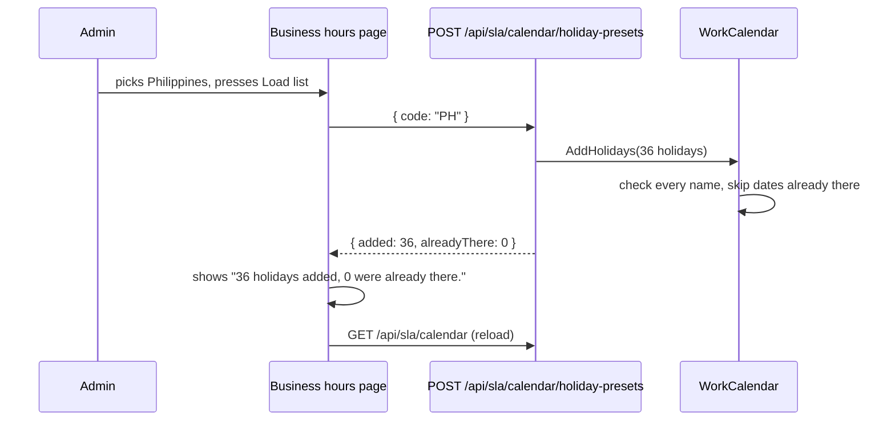

# Lesson 23 — Holidays and the Business Hours Screen

Good day, developer! Last time we built a calendar that counts only open time, and gave an Admin four endpoints to change it. Nobody wants to type 36 holidays by hand, and nobody should have to use `curl` to change a working week. Today we add the quick ways in: a country's holidays in one click, and a file import for everything else. Then we give the calendar its screen. It takes about two hours. Are you ready? Let's begin!

## What we'll build

| Piece | What it is |
|---|---|
| **Holiday lists** | A ready-made list of a country's holidays. The Philippines ships, for 2026 and 2027 |
| **CSV import** | Paste a file of `date,name` lines; a bad line refuses the whole file and names the line |
| **The Business hours screen** | The week, the time zone, the holidays, the list picker and the import box on one page, for Admins |
| **A new `ApiClient` call** | One that gives back an answer, such as how many holidays a list added |

## Why we build it this way

### The pain: a calendar with an empty holiday table

An installation that starts with no holidays counts Christmas Day as a working day. The first breach report of the year says the team missed a deadline on a day the building was shut. An Admin could add every holiday through the endpoint from last time, but 18 a year, every year, is exactly the sort of chore that gets skipped.

### The fix: lists we ship, and a way in for everything else

We ship the holidays we can read from the government's own proclamations, and we say exactly what we left out. For any other country, or for a holiday a company declares on its own, there is a file import. Both ways in end in one domain method, so a list and a file follow the same rules.

### Now, let's be honest about the cost here

A shipped list is data that goes out of date. The Philippine list covers 2026 and 2027, from Proclamation No. 1006 and Proclamation No. 1427, which are the national proclamations (on [lawphil.net](https://lawphil.net)). Two kinds of holiday are not in it, on purpose. Eid'l Fitr and Eid'l Adha: the proclamations say their dates are set later, by separate proclamations, so we cannot know them. And days that apply to one region only, such as the three special days in Metro Manila in November 2026. An Admin adds those on the screen. When 2028 is proclaimed, someone has to read the new proclamation and update the list. A product that runs a help desk must not guess a holiday, so we wrote down what we know and left the rest to people.

## 1. A list of holidays, and a file of them

Both ways in take a list of holidays, and both must refuse a bad name and skip a date that is already there. We add one method to the calendar for that, and change `AddHoliday` to share its name check:

```csharp
// src/Modules/Sla/Yasda.Modules.Sla/Domain/WorkCalendar.cs (added)
    public void AddHoliday(DateOnly date, string name, UserId by, string byName, DateTime nowUtc)
    {
        var text = CheckedHolidayName(name);
        if (FindHoliday(date) is not null) throw new DomainException(SlaErrors.HolidayAlreadyListed);

        _holidays.Add(new Holiday(date, text));
        Touch(by, byName, nowUtc);
    }

    // Adds many holidays at once (a country's list, or a file). A date that is already a holiday keeps its name, so loading
    // the same list twice changes nothing. Returns how many were new. If one holiday is refused, none are added.
    public int AddHolidays(IReadOnlyList<PresetHoliday> holidays, UserId by, string byName, DateTime nowUtc)
    {
        var added = new List<Holiday>();
        var datesSeen = new HashSet<DateOnly>();
        foreach (var holiday in _holidays)
        {
            datesSeen.Add(holiday.Date);
        }

        foreach (var incoming in holidays)
        {
            var name = CheckedHolidayName(incoming.Name);
            if (!datesSeen.Add(incoming.Date)) continue;
            added.Add(new Holiday(incoming.Date, name));
        }

        if (added.Count == 0) return 0;

        _holidays.AddRange(added);
        Touch(by, byName, nowUtc);
        return added.Count;
    }
```

```csharp
// src/Modules/Sla/Yasda.Modules.Sla/Domain/WorkCalendar.cs (added)
    private static string CheckedHolidayName(string name)
    {
        var text = name?.Trim() ?? "";
        if (text.Length == 0 || text.Length > HolidayNameMaxLength) throw new DomainException(SlaErrors.HolidayNameRequired);
        return text;
    }
```

Read `AddHolidays` once more: it checks every name before it changes anything, so one bad holiday in a list adds none of them. A date that is already a holiday keeps its name, so loading the same list twice does nothing the second time.

The Philippine list is plain data in the domain. The comment says what is left out and why:

```csharp
// src/Modules/Sla/Yasda.Modules.Sla/Domain/HolidayPresets.cs
namespace Yasda.Modules.Sla.Domain;

internal sealed record PresetHoliday(DateOnly Date, string Name);

// A country's holidays, ready to load into the calendar with one click. These come from the proclamations themselves, not from
// memory: for the Philippines, Proclamation No. 1006 (2026) and Proclamation No. 1427 (2027), both on https://lawphil.net.
//
// Left out on purpose, so an Admin adds them once they apply to the installation:
//   - Eid'l Fitr and Eid'l Adha: the proclamations say their dates are set later, by separate proclamations.
//   - Holidays that apply to one region only (such as the Metro Manila days of 16-18 November 2026).
//   - The "special working day" of 25 February: it is a normal working day.
internal sealed record HolidayPreset(string Code, string Country, IReadOnlyList<PresetHoliday> Holidays)
{
    private static readonly HolidayPreset Philippines = new("PH", "Philippines",
    [
        new(new DateOnly(2026, 1, 1), "New Year's Day"),
        new(new DateOnly(2026, 2, 17), "Chinese New Year"),
        new(new DateOnly(2026, 4, 2), "Maundy Thursday"),
        new(new DateOnly(2026, 4, 3), "Good Friday"),
        new(new DateOnly(2026, 4, 4), "Black Saturday"),
        new(new DateOnly(2026, 4, 9), "Araw ng Kagitingan"),
        new(new DateOnly(2026, 5, 1), "Labor Day"),
        new(new DateOnly(2026, 6, 12), "Independence Day"),
        new(new DateOnly(2026, 8, 21), "Ninoy Aquino Day"),
        new(new DateOnly(2026, 8, 31), "National Heroes Day"),
        new(new DateOnly(2026, 11, 1), "All Saints' Day"),
        new(new DateOnly(2026, 11, 2), "All Souls' Day"),
        new(new DateOnly(2026, 11, 30), "Bonifacio Day"),
        new(new DateOnly(2026, 12, 8), "Feast of the Immaculate Conception of Mary"),
        new(new DateOnly(2026, 12, 24), "Christmas Eve"),
        new(new DateOnly(2026, 12, 25), "Christmas Day"),
        new(new DateOnly(2026, 12, 30), "Rizal Day"),
        new(new DateOnly(2026, 12, 31), "Last Day of the Year"),

        new(new DateOnly(2027, 1, 1), "New Year's Day"),
        new(new DateOnly(2027, 2, 6), "Chinese New Year"),
        new(new DateOnly(2027, 3, 25), "Maundy Thursday"),
        new(new DateOnly(2027, 3, 26), "Good Friday"),
        new(new DateOnly(2027, 3, 27), "Black Saturday"),
        new(new DateOnly(2027, 4, 9), "Araw ng Kagitingan"),
        new(new DateOnly(2027, 5, 1), "Labor Day"),
        new(new DateOnly(2027, 6, 12), "Independence Day"),
        new(new DateOnly(2027, 8, 21), "Ninoy Aquino Day"),
        new(new DateOnly(2027, 8, 30), "National Heroes Day"),
        new(new DateOnly(2027, 11, 1), "All Saints' Day"),
        new(new DateOnly(2027, 11, 2), "All Souls' Day"),
        new(new DateOnly(2027, 11, 30), "Bonifacio Day"),
        new(new DateOnly(2027, 12, 8), "Feast of the Immaculate Conception of Mary"),
        new(new DateOnly(2027, 12, 24), "Christmas Eve"),
        new(new DateOnly(2027, 12, 25), "Christmas Day"),
        new(new DateOnly(2027, 12, 30), "Rizal Day"),
        new(new DateOnly(2027, 12, 31), "Last Day of the Year"),
    ]);

    // After the lists above it: static fields are filled in the order they are written.
    public static readonly IReadOnlyList<HolidayPreset> All = [Philippines];

    public static HolidayPreset? Find(string code)
    {
        foreach (var preset in All)
        {
            if (string.Equals(preset.Code, code, StringComparison.OrdinalIgnoreCase)) return preset;
        }
        return null;
    }
}
```

One thing to watch out for: `All` is declared after `Philippines`. C# fills static fields in the order they are written, so a list declared first would be built from a field that is still `null`. The comment says so, because it is the kind of line a tidy-up moves.

A file is parsed by a small static class. It reads `date,name` lines. A first line that says `date,name` is a header, blank lines are skipped, and a name may contain commas. The rule that matters is the last one: **if any line is wrong, nothing is imported**, and the message says which line:

```csharp
// src/Modules/Sla/Yasda.Modules.Sla/Domain/HolidayCsv.cs
using System.Globalization;
using Yasda.Shared.BuildingBlocks;

namespace Yasda.Modules.Sla.Domain;

// Turns the text of a CSV file into holidays. One holiday per line: a date as 2026-12-25, a comma, and the name. A first line
// that reads "date,name" is a header and is skipped, and so are blank lines. A line that can't be read refuses the whole file,
// with its line number, so nothing is half imported.
internal static class HolidayCsv
{
    public static List<PresetHoliday> Parse(string csv)
    {
        var holidays = new List<PresetHoliday>();
        var lines = csv.Split('\n');

        for (var index = 0; index < lines.Length; index++)
        {
            var number = index + 1;
            var line = lines[index].Trim();
            if (line.Length == 0) continue;
            if (number == 1 && IsHeader(line)) continue;

            var comma = line.IndexOf(',');
            if (comma < 0) throw LineProblem(number, "it needs a date, a comma and a name");

            var dateText = line[..comma].Trim();
            var name = line[(comma + 1)..].Trim().Trim('"');
            if (!DateOnly.TryParseExact(dateText, "yyyy-MM-dd", CultureInfo.InvariantCulture, DateTimeStyles.None, out var date))
                throw LineProblem(number, $"'{dateText}' is not a date written like 2026-12-25");
            if (name.Length == 0) throw LineProblem(number, "the holiday has no name");

            holidays.Add(new PresetHoliday(date, name));
        }

        return holidays;
    }

    private static bool IsHeader(string line)
    {
        var lower = line.ToLowerInvariant().Replace(" ", "");
        return lower == "date,name";
    }

    private static DomainException LineProblem(int number, string why)
    {
        return new DomainException(SlaErrors.HolidayLineInvalid, $"Line {number}: {why}.");
    }
}
```

Two error codes go in the catalog:

```csharp
// src/Modules/Sla/Yasda.Modules.Sla/Domain/SlaErrors.cs (added)
    public static readonly ErrorCode HolidayLineInvalid = new("SLA-0009", "A line of the holiday file can't be read",
        "Write each holiday on its own line as a date and a name, like 2026-12-25,Christmas Day. Fix the line named in the message and import again.");
    public static readonly ErrorCode UnknownHolidayPreset = new("SLA-0010", "That holiday list isn't known",
        "Pick one of the lists the calendar screen offers. Anything else can be imported from a file.");
}
```

## 2. The endpoints

Three endpoints, one handler. Listing the lists, loading one, and importing a file. They are Admin-only, like the rest of the calendar:

```csharp
// src/Modules/Sla/Yasda.Modules.Sla/Features/Calendar/ImportHolidays.cs
using FluentValidation;
using Yasda.Modules.Identity.Contracts;
using Yasda.Modules.Sla.Domain;
using Yasda.Modules.Sla.Infrastructure;
using Yasda.Shared.BuildingBlocks;
using Microsoft.AspNetCore.Builder;
using Microsoft.AspNetCore.Http;
using Microsoft.AspNetCore.Http.HttpResults;
using Microsoft.AspNetCore.Routing;
using Microsoft.EntityFrameworkCore;

namespace Yasda.Modules.Sla.Features;

internal sealed record PresetDto(string Code, string Country, int Holidays);
internal sealed record ImportResult(int Added, int AlreadyThere);

internal sealed record LoadPresetCommand(string Code);
internal sealed record ImportCsvCommand(string Csv);

// Two ways to add many holidays: a country's ready-made list, and a CSV file. Both end in the calendar's AddHolidays.
internal sealed class ImportHolidaysHandler(SlaDbContext db, ICurrentUser currentUser, IUserDirectory users, TimeProvider time)
{
    public static List<PresetDto> ListPresets()
    {
        var presets = new List<PresetDto>();
        foreach (var preset in HolidayPreset.All)
        {
            presets.Add(new PresetDto(preset.Code, preset.Country, preset.Holidays.Count));
        }
        return presets;
    }

    public async Task<ImportResult> LoadPresetAsync(LoadPresetCommand cmd, CancellationToken ct)
    {
        var preset = HolidayPreset.Find(cmd.Code);
        if (preset is null) throw new DomainException(SlaErrors.UnknownHolidayPreset, $"There is no holiday list '{cmd.Code}'.");

        return await AddAsync(preset.Holidays.ToList(), ct);
    }

    public async Task<ImportResult> ImportCsvAsync(ImportCsvCommand cmd, CancellationToken ct)
    {
        var holidays = HolidayCsv.Parse(cmd.Csv);
        return await AddAsync(holidays, ct);
    }

    private async Task<ImportResult> AddAsync(List<PresetHoliday> holidays, CancellationToken ct)
    {
        var calendar = await db.Calendars.Include(c => c.Holidays).SingleAsync(ct);

        var myName = await users.NameOfAsync(currentUser.UserId, ct) ?? currentUser.Username;
        var added = calendar.AddHolidays(holidays, new UserId(currentUser.UserId), myName, time.GetUtcNow().UtcDateTime);
        await db.SaveChangesAsync(ct);

        return new ImportResult(added, holidays.Count - added);
    }
}

internal sealed record LoadPresetRequest(string Code);
internal sealed record ImportCsvRequest(string Csv);

// A file bigger than this isn't a list of holidays.
internal sealed class ImportCsvRequestValidator : AbstractValidator<ImportCsvRequest>
{
    public ImportCsvRequestValidator()
    {
        RuleFor(x => x.Csv).NotEmpty().MaximumLength(100_000);
    }
}

internal static class ImportHolidaysEndpoints
{
    public static void Map(IEndpointRouteBuilder app)
    {
        app.MapGet("/sla/calendar/holiday-presets", Ok<List<PresetDto>> () =>
        {
            return TypedResults.Ok(ImportHolidaysHandler.ListPresets());
        })
        .RequireAuthorization(policy => policy.RequireRole(SlaRoles.CalendarEditors));

        app.MapPost("/sla/calendar/holiday-presets", async Task<Ok<ImportResult>> (LoadPresetRequest body, ImportHolidaysHandler handler, CancellationToken ct) =>
        {
            var result = await handler.LoadPresetAsync(new LoadPresetCommand(body.Code), ct);
            return TypedResults.Ok(result);
        })
        .RequireAuthorization(policy => policy.RequireRole(SlaRoles.CalendarEditors));

        app.MapPost("/sla/calendar/holidays/import", async Task<Ok<ImportResult>> (ImportCsvRequest body, ImportHolidaysHandler handler, CancellationToken ct) =>
        {
            var result = await handler.ImportCsvAsync(new ImportCsvCommand(body.Csv), ct);
            return TypedResults.Ok(result);
        })
        .RequireAuthorization(policy => policy.RequireRole(SlaRoles.CalendarEditors));
    }
}
```

Register the handler with the others in `AddSlaModule`, and map the endpoints in `MapSlaEndpoints`:

```csharp
// src/Modules/Sla/Yasda.Modules.Sla/SlaModule.cs (added)
        services.AddScoped<ImportHolidaysHandler>();
```

```csharp
// src/Modules/Sla/Yasda.Modules.Sla/SlaModule.cs (added)
        ImportHolidaysEndpoints.Map(sla);
```

The file travels as a string inside JSON, not as a multipart upload. That keeps it inside the one validation filter every `/api` request goes through, which can refuse an empty file or one over 100,000 characters before the handler sees it.

## 3. The screen

Now the page. Before you write any `.razor`, remember the rules from [lesson 06](06-sign-in.md): plain HTML, Blazor's own inputs, `.field` for a label above its input, no modal dialogs. Removing a holiday asks inline, naming it, with verb buttons.

First, a screen needs the shapes the API sends. Add them to `Models.cs`:

```csharp
// src/Yasda.Web/Models/Models.cs (added)
// The organization's calendar: when it is open and when it is closed. Times come as "08:00:00"; a closed day has none.
public sealed record CalendarDay(string DayOfWeek, TimeOnly? Opens, TimeOnly? Closes);

public sealed record CalendarHoliday(DateOnly HolidayDate, string Name);

public sealed record BusinessCalendar(string TimeZoneId, DateTime UpdatedUtc, string UpdatedByName, List<CalendarDay> Days, List<CalendarHoliday> Holidays);

public sealed record HolidayPreset(string Code, string Country, int Holidays);

public sealed record HolidaysLoaded(int Added, int AlreadyThere);
```

The page needs something `ApiClient` could not do: a `POST` that gives an answer back ("36 holidays added, 0 were already there"). Add a generic `Post` next to the others, in `ApiClient.cs`:

```csharp
// src/Yasda.Web/Services/ApiClient.cs (added)
    // For actions that answer with a result, such as how many holidays a list added. null when the API said no.
    public async Task<T?> Post<T>(string url, object body)
    {
        var response = await Change(() => http.PostAsJsonAsync(url, body));
        if (!response.IsSuccessStatusCode) return await Fail<T>(response);
        return await response.Content.ReadFromJsonAsync<T>();
    }
```

Admins get a link in the nav bar, in the Admin block of `NavMenu.razor`:

```razor
@* src/Yasda.Web/Layout/NavMenu.razor (added) *@
        <AuthorizeView Roles="@Roles.Admin">
            <li><NavItem Href="users">Users</NavItem></li>
            <li><NavItem Href="teams">Teams</NavItem></li>
            <li><NavItem Href="business-hours">Business hours</NavItem></li>
            <li><NavItem Href="sign-in-log">Sign-in log</NavItem></li>
        </AuthorizeView>
```

And here is the page itself. It has four parts: the week with its time zone, the holiday list, the list picker, and the import box. A closed weekday shows only its checkbox; an open one shows its two times. A form's state is plain fields until Save sends it:

```razor
@* src/Yasda.Web/Pages/Admin/BusinessHours.razor *@
@page "/business-hours"
@attribute [Authorize(Roles = Roles.Admin)]
@inject ApiClient Api
@inject Notices Notices

<PageTitle>Business hours · YASDA</PageTitle>

<PageHeader Title="Business hours">
    <Description>
        When your organization is open. Deadlines count only open time: a ticket filed on Friday evening starts its clock on Monday
        morning, and a holiday is skipped like a weekend.
    </Description>
</PageHeader>

@if (_calendar is null)
{
    <p role="status">Loading…</p>
}
else
{
    <EditForm Model="this" OnSubmit="SaveWeek">
        <h2>Working week</h2>
        <div class="field">
            <label for="time-zone">Time zone</label>
            <InputText id="time-zone" @bind-Value="_timeZoneId" aria-describedby="time-zone-hint" />
            <span id="time-zone-hint" class="hint">A name such as Asia/Manila or America/New_York. It also decides what "today" means in the app.</span>
        </div>
        @foreach (var day in _days)
        {
            <fieldset>
                <legend>@day.Name</legend>
                <div class="check">
                    <InputCheckbox id="@($"open-{day.Name}")" @bind-Value="day.IsOpen" />
                    <label for="@($"open-{day.Name}")">Open on @day.Name</label>
                </div>
                @if (day.IsOpen)
                {
                    <div class="field">
                        <label for="@($"opens-{day.Name}")">@day.Name opens at</label>
                        <InputText id="@($"opens-{day.Name}")" type="time" @bind-Value="day.Opens" required />
                    </div>
                    <div class="field">
                        <label for="@($"closes-{day.Name}")">@day.Name closes at</label>
                        <InputText id="@($"closes-{day.Name}")" type="time" @bind-Value="day.Closes" required />
                    </div>
                }
            </fieldset>
        }
        <p class="muted">Last changed by @_calendar.UpdatedByName, <TimeAgo Utc="_calendar.UpdatedUtc" />.</p>
        <div class="actions">
            <button type="submit" disabled="@Api.Busy">Save working week</button>
        </div>
    </EditForm>

    <h2>Holidays</h2>
    @if (_calendar.Holidays.Count == 0)
    {
        <p>No holidays yet. Load a country's list, import a file, or add a date below.</p>
    }
    else
    {
        <TableBox Label="Holidays">
            <table>
                <thead>
                    <tr>
                        <th scope="col">Date</th>
                        <th scope="col">Name</th>
                        <th scope="col">Remove</th>
                    </tr>
                </thead>
                <tbody>
                    @foreach (var holiday in _calendar.Holidays)
                    {
                        <tr>
                            <td>@holiday.HolidayDate.ToString("yyyy-MM-dd")</td>
                            <td>@holiday.Name</td>
                            <td>
                                @if (_removing == holiday.HolidayDate)
                                {
                                    <button type="button" @onclick="() => RemoveHoliday(holiday)" disabled="@Api.Busy" aria-label="@($"Yes, remove {holiday.Name}")">Remove</button>
                                    <button type="button" @onclick="() => _removing = null">Not yet</button>
                                }
                                else
                                {
                                    <button type="button" @onclick="() => _removing = holiday.HolidayDate" aria-label="@($"Remove {holiday.Name}")">Remove…</button>
                                }
                            </td>
                        </tr>
                    }
                </tbody>
            </table>
        </TableBox>
        @if (_removing is not null)
        {
            <p role="alert">Remove this holiday? Deadlines will count that day as a working day again.</p>
        }
    }

    <EditForm Model="this" OnSubmit="AddHoliday" class="search">
        <div class="field">
            <label for="holiday-date">Date</label>
            <InputText id="holiday-date" type="date" @bind-Value="_newDate" required />
        </div>
        <div class="field">
            <label for="holiday-name">Name</label>
            <InputText id="holiday-name" @bind-Value="_newName" required />
        </div>
        <div class="actions">
            <button type="submit" disabled="@Api.Busy">Add holiday</button>
        </div>
    </EditForm>

    <h2>Load a country's holidays</h2>
    <p>
        Adds every holiday of the list you pick. A date that is already a holiday keeps its name, so loading a list twice does no harm.
        Holidays announced later, such as Eid'l Fitr and Eid'l Adha, are not in a list: add them above once they are proclaimed.
    </p>
    <EditForm Model="this" OnSubmit="LoadPreset" class="search">
        <div class="field">
            <label for="preset">Holiday list</label>
            <InputSelect id="preset" @bind-Value="_presetCode">
                @foreach (var preset in _presets)
                {
                    <option value="@preset.Code">@preset.Country (@preset.Holidays holidays)</option>
                }
            </InputSelect>
        </div>
        <div class="actions">
            <button type="submit" disabled="@Api.Busy">Load list</button>
        </div>
    </EditForm>

    <h2>Import holidays from a file</h2>
    <EditForm Model="this" OnSubmit="ImportCsv">
        <div class="field">
            <label for="csv">Holidays, one per line</label>
            <InputTextArea id="csv" @bind-Value="_csv" rows="6" aria-describedby="csv-hint" />
            <span id="csv-hint" class="hint">Each line is a date and a name, like 2026-12-25,Christmas Day. Paste the contents of a CSV file. If one line can't be read, nothing is added.</span>
        </div>
        <div class="actions">
            <button type="submit" disabled="@Api.Busy">Import holidays</button>
        </div>
    </EditForm>
}

@code {
    // One per weekday: the hours as typed, until Save sends them.
    private sealed class DayEdit
    {
        public string Name { get; init; } = "";
        public bool IsOpen { get; set; }
        public string Opens { get; set; } = "08:00";
        public string Closes { get; set; } = "17:00";
    }

    private BusinessCalendar? _calendar;
    private List<DayEdit> _days = [];
    private string _timeZoneId = "";
    private List<HolidayPreset> _presets = [];
    private string _presetCode = "";
    private string _newDate = "";
    private string _newName = "";
    private string _csv = "";
    private DateOnly? _removing;

    protected override async Task OnInitializedAsync()
    {
        await Load();
        var presets = await Api.Get<List<HolidayPreset>>("api/sla/calendar/holiday-presets");
        if (presets is null) return;

        _presets = presets;
        if (presets.Count > 0) _presetCode = presets[0].Code;
    }

    private async Task Load()
    {
        var calendar = await Api.Get<BusinessCalendar>("api/sla/calendar");
        if (calendar is null) return;

        var days = new List<DayEdit>();
        foreach (var day in calendar.Days)
        {
            var edit = new DayEdit { Name = day.DayOfWeek, IsOpen = day.Opens is not null };
            if (day.Opens is not null) edit.Opens = day.Opens.Value.ToString("HH:mm");
            if (day.Closes is not null) edit.Closes = day.Closes.Value.ToString("HH:mm");
            days.Add(edit);
        }

        _calendar = calendar;
        _days = days;
        _timeZoneId = calendar.TimeZoneId;
        _removing = null;
    }

    // Whether or not it worked, show the calendar as it is now: a refused change should not look saved.
    private async Task SaveWeek()
    {
        var sent = new List<object>();
        foreach (var day in _days)
        {
            if (day.IsOpen) sent.Add(new { day = day.Name, opens = day.Opens, closes = day.Closes });
            else sent.Add(new { day = day.Name, opens = (string?)null, closes = (string?)null });
        }

        await Api.Put("api/sla/calendar", new { timeZoneId = _timeZoneId.Trim(), days = sent }, "Working week saved.");
        await Load();
    }

    private async Task AddHoliday()
    {
        var added = await Api.Post("api/sla/calendar/holidays", new { date = _newDate, name = _newName }, "Holiday added.");
        if (added)
        {
            _newDate = "";
            _newName = "";
        }
        await Load();
    }

    private async Task RemoveHoliday(CalendarHoliday holiday)
    {
        await Api.Delete($"api/sla/calendar/holidays/{holiday.HolidayDate:yyyy-MM-dd}", $"{holiday.Name} removed.");
        await Load();
    }

    private async Task LoadPreset()
    {
        var result = await Api.Post<HolidaysLoaded>("api/sla/calendar/holiday-presets", new { code = _presetCode });
        if (result is not null) Notices.Success($"{result.Added} holidays added, {result.AlreadyThere} were already there.");
        await Load();
    }

    private async Task ImportCsv()
    {
        var result = await Api.Post<HolidaysLoaded>("api/sla/calendar/holidays/import", new { csv = _csv });
        if (result is not null)
        {
            Notices.Success($"{result.Added} holidays added, {result.AlreadyThere} were already there.");
            _csv = "";
        }
        await Load();
    }
}
```

A few lines are worth a sentence. The two times are `<input type="time">`, bound to strings like `08:00`, and the API reads those. `Save` and every other action reload the calendar whether or not it worked, so a refused change never looks saved. The Remove button asks first: `_removing` holds the date being confirmed, and the button's accessible name says which holiday, because a screen reader reads "Remove" nine times otherwise.

## 4. Prove it: the lists, the file and the screen

First the unit tests. They run with no database. The first test file covers the parser and the list:

```csharp
// tests/Yasda.Modules.Sla.UnitTests/HolidayImportTests.cs (the top of the new file; the tests below go inside the class)
using AwesomeAssertions;
using Yasda.Modules.Sla.Domain;
using Yasda.Shared.BuildingBlocks;

namespace Yasda.Modules.Sla.UnitTests;

public class HolidayImportTests
{
    private static readonly DateTime Now = new(2026, 11, 21, 9, 0, 0, DateTimeKind.Utc);
    private static readonly UserId Admin = new(1);

    private static WorkCalendar NewCalendar()
    {
        return WorkCalendar.Create("Asia/Manila", [new WorkDay(DayOfWeek.Monday, new TimeOnly(8, 0), new TimeOnly(17, 0))], Admin, "Dyst", Now);
    }

    private static ErrorCode CodeOf(Action act)
    {
        return act.Should().Throw<DomainException>().Which.Error;
    }
    // ... the tests that follow
```

```csharp
// tests/Yasda.Modules.Sla.UnitTests/HolidayImportTests.cs (added)
    [Theory]
    [InlineData("2026-12-25", 1)]                       // no comma
    [InlineData("25/12/2026,Christmas Day", 1)]         // not a yyyy-MM-dd date
    [InlineData("2026-12-25,", 1)]                      // no name
    [InlineData("2026-12-25,Christmas Day\n2026-13-01,Nope", 2)]
    public void A_line_that_cant_be_read_refuses_the_whole_file_and_names_the_line(string csv, int badLine)
    {
        var exception = new Action(() => HolidayCsv.Parse(csv)).Should().Throw<DomainException>().Which;

        exception.Error.Should().Be(SlaErrors.HolidayLineInvalid);
        exception.Message.Should().StartWith($"Line {badLine}:");
    }
```

```csharp
// tests/Yasda.Modules.Sla.UnitTests/HolidayImportTests.cs (added)
    [Fact]
    public void The_philippine_list_has_each_date_once_with_a_usable_name_and_only_the_two_years_proclaimed()
    {
        var preset = HolidayPreset.Find("ph")!;

        preset.Country.Should().Be("Philippines");
        preset.Holidays.Select(h => h.Date).Should().OnlyHaveUniqueItems();
        preset.Holidays.Should().OnlyContain(h => h.Date.Year == 2026 || h.Date.Year == 2027);
        preset.Holidays.Should().OnlyContain(h => h.Name.Length > 0 && h.Name.Length <= WorkCalendar.HolidayNameMaxLength);
        preset.Holidays.Count(h => h.Date.Year == 2026).Should().Be(18);
        preset.Holidays.Count(h => h.Date.Year == 2027).Should().Be(18);
        preset.Holidays.Should().NotContain(h => h.Date == new DateOnly(2026, 2, 25), "the EDSA day is a special working day");
        preset.Holidays.Should().NotContain(h => h.Name.Contains("Eid"), "their dates are proclaimed later");
    }
```

| Test | Why it matters |
|---|---|
| `A_csv_with_a_header_blank_lines_and_quoted_names_is_read` | The file formats people really paste |
| `A_name_may_contain_a_comma` | "Feast of the Immaculate Conception, Mary" |
| `Loading_a_list_adds_the_new_dates_and_keeps_the_names_of_dates_already_there` | A list never renames what an Admin wrote |
| `Loading_the_same_list_twice_changes_nothing_the_second_time` | Safe to click twice |
| `One_bad_holiday_in_a_list_adds_none_of_them` | All or nothing |
| `An_unknown_list_is_not_found` | A code that is no list |

Then the API, in the file from last time. Three new tests:

```csharp
// tests/Yasda.Integration.Tests/SlaCalendarTests.cs (added)
    [Fact]
    public async Task The_philippine_list_loads_once_and_loading_it_again_adds_nothing()
    {
        var admin = await factory.ClientFor(Admin);
        try
        {
            var presets = await admin.GetFromJsonAsync<JsonElement[]>("/api/sla/calendar/holiday-presets");
            presets!.Single().GetProperty("code").GetString().Should().Be("PH");

            var first = await admin.PostAsJsonAsync("/api/sla/calendar/holiday-presets", new { code = "PH" });
            var second = await admin.PostAsJsonAsync("/api/sla/calendar/holiday-presets", new { code = "ph" });

            (await first.Content.ReadFromJsonAsync<Loaded>())!.Added.Should().Be(36);
            (await second.Content.ReadFromJsonAsync<Loaded>()).Should().Be(new Loaded(0, 36));
            var calendar = await ReadAsync(admin);
            calendar.Holidays.Should().Contain(new Holiday("2026-12-25", "Christmas Day"));
            calendar.Holidays.Should().Contain(new Holiday("2027-11-30", "Bonifacio Day"));
        }
        finally
        {
            await ClearHolidaysAsync(admin);
        }
    }
```

```csharp
// tests/Yasda.Integration.Tests/SlaCalendarTests.cs (added)
    [Fact]
    public async Task A_csv_file_adds_its_holidays_and_a_bad_line_adds_none_of_them()
    {
        var admin = await factory.ClientFor(Admin);
        try
        {
            var bad = await admin.PostAsJsonAsync("/api/sla/calendar/holidays/import", new { csv = "date,name\n2026-12-25,Christmas Day\n2026-13-45,Oops" });
            var unknown = await admin.PostAsJsonAsync("/api/sla/calendar/holiday-presets", new { code = "XX" });

            bad.StatusCode.Should().Be(HttpStatusCode.UnprocessableEntity);
            (await CodeOf(bad)).Should().Be("SLA-0009");
            (await CodeOf(unknown)).Should().Be("SLA-0010");
            (await ReadAsync(admin)).Holidays.Should().BeEmpty("a bad file adds nothing");

            var good = await admin.PostAsJsonAsync("/api/sla/calendar/holidays/import", new { csv = "date,name\n2026-12-25,Christmas Day\n2026-12-26,Boxing Day\n" });

            (await good.Content.ReadFromJsonAsync<Loaded>()).Should().Be(new Loaded(2, 0));
            (await ReadAsync(admin)).Holidays.Select(h => h.Name).Should().Equal("Christmas Day", "Boxing Day");
        }
        finally
        {
            await ClearHolidaysAsync(admin);
        }
    }
```

| Test | Why it matters |
|---|---|
| `Only_an_admin_may_load_a_list_or_import_a_file` | A team lead gets a 403 on all three endpoints |

And the browser. Like every screen test, these find things by role and name, never by CSS:

```csharp
// tests/Yasda.Web.UiTests/BusinessHoursUiTests.cs (the top of the new file; the tests below go inside the class)
using Microsoft.Playwright;
using static Microsoft.Playwright.Assertions;

namespace Yasda.Web.UiTests;

public sealed class BusinessHoursUiTests : UiTest
{
    // ... the tests that follow
```

```csharp
// tests/Yasda.Web.UiTests/BusinessHoursUiTests.cs (added)
    [UiFact]
    public async Task An_admin_adds_imports_and_removes_holidays_and_loads_a_countrys_list()
    {
        var page = await SignIn("admin@yasda.local");
        await page.GotoAsync("/business-hours");

        await page.GetByLabel("Date").FillAsync("2090-03-04");
        await page.GetByLabel("Name").FillAsync("Founders' Day");
        await page.GetByRole(AriaRole.Button, new() { Name = "Add holiday" }).ClickAsync();
        await Expect(StatusSaying(page, "Holiday added.")).ToBeVisibleAsync();
        await Expect(page.GetByRole(AriaRole.Cell, new() { Name = "Founders' Day", Exact = true })).ToBeVisibleAsync();

        await page.GetByLabel("Holidays, one per line").FillAsync("date,name\n2090-03-05,Day after\nnot a date,Oops");
        await page.GetByRole(AriaRole.Button, new() { Name = "Import holidays" }).ClickAsync();
        await Expect(page.GetByRole(AriaRole.Alert)).ToContainTextAsync("Line 3");
        await Expect(page.GetByRole(AriaRole.Cell, new() { Name = "Day after", Exact = true })).ToHaveCountAsync(0);

        await page.GetByLabel("Holidays, one per line").FillAsync("date,name\n2090-03-05,Day after");
        await page.GetByRole(AriaRole.Button, new() { Name = "Import holidays" }).ClickAsync();
        await Expect(StatusSaying(page, "1 holidays added, 0 were already there.")).ToBeVisibleAsync();
        await Expect(page.GetByRole(AriaRole.Cell, new() { Name = "Day after", Exact = true })).ToBeVisibleAsync();

        await page.GetByRole(AriaRole.Button, new() { Name = "Load list" }).ClickAsync();
        await Expect(StatusSaying(page, " were already there.")).ToBeVisibleAsync();
        await Expect(page.GetByRole(AriaRole.Cell, new() { Name = "Christmas Day", Exact = true }).First).ToBeVisibleAsync();

        await page.GetByRole(AriaRole.Button, new() { Name = "Remove Founders' Day" }).ClickAsync();
        await Expect(page.GetByRole(AriaRole.Alert)).ToContainTextAsync("Remove this holiday?");
        await page.GetByRole(AriaRole.Button, new() { Name = "Not yet" }).ClickAsync();
        await Expect(page.GetByRole(AriaRole.Cell, new() { Name = "Founders' Day", Exact = true })).ToBeVisibleAsync();

        await page.GetByRole(AriaRole.Button, new() { Name = "Remove Founders' Day" }).ClickAsync();
        await page.GetByRole(AriaRole.Button, new() { Name = "Yes, remove Founders' Day" }).ClickAsync();
        await Expect(StatusSaying(page, "Founders' Day removed.")).ToBeVisibleAsync();
        await Expect(page.GetByRole(AriaRole.Cell, new() { Name = "Founders' Day", Exact = true })).ToHaveCountAsync(0);

        await page.GetByRole(AriaRole.Button, new() { Name = "Remove Day after" }).ClickAsync();
        await page.GetByRole(AriaRole.Button, new() { Name = "Yes, remove Day after" }).ClickAsync();
        await Expect(StatusSaying(page, "Day after removed.")).ToBeVisibleAsync();
    }
```

| Test | Why it matters |
|---|---|
| `An_admin_opens_saturday_for_a_morning_and_closes_it_again` | The week form, saved and put back |
| `A_closing_time_before_the_opening_time_is_refused_with_its_code` | The page shows the API's refusal, and shows the week as it still is |
| `Someone_who_is_not_an_admin_neither_sees_nor_opens_the_business_hours_page` | No link, and the page says so if you type the address |

### Make each one fail once

In `HolidayCsv.Parse`, change `number == 1 && IsHeader(line)` to `false` and run the unit tests: `A_csv_with_a_header_blank_lines_and_quoted_names_is_read` fails, because "Date,Name" is no date. Put it back. In the page, delete the line `await Load();` at the end of `AddHoliday` and run the browser test: the holiday is added but the table never shows it, so the test fails on the cell it waits for. Put it back.

## How a request flows

An Admin loads the Philippine list:



## Mistakes to avoid

- Seeding holidays from memory. A wrong date on a help desk's calendar is worse than a missing one, because nobody checks it.
- Importing the good lines of a file and skipping the bad ones. Nobody finds out which holidays are missing.
- Letting a list rename a holiday an Admin already named.
- Declaring a static list before the lists it is built from. C# builds static fields in the order you wrote them.
- Showing a button named only "Remove" in a table of holidays. A screen reader user hears nine of them. Name the one they are removing.
- Leaving the page showing the old calendar after a refused change.

## Let's run it!

```bash
dotnet build Yasda.slnx
dotnet test --solution Yasda.slnx
dotnet run --project src/Yasda.Api
```

Sign in as `admin@yasda.local` and open "Business hours" in the menu. Pick "Philippines" and press "Load list". The page says "36 holidays added, 0 were already there." and the table shows them in date order. Press "Load list" again: it says "0 holidays added, 36 were already there." Paste `2090-03-04,Founders' Day` into the import box and press "Import holidays", then remove it again. To run the browser tests, give them the address of the running app, as you did in lesson 06.

## Let's check!

1. Why does a list of holidays go through one domain method, `AddHolidays`, instead of adding them one at a time from the handler?
2. What happens when one line of an imported file is wrong, and why?
3. Which two kinds of holiday are not in the Philippine list, and why?
4. Why does loading a list twice change nothing the second time?
5. Why is the file sent as a string in JSON and not as an upload?
6. Why does the Remove button's accessible name include the holiday's name?
7. Why does every action on the page reload the calendar, even when it was refused?

And that's where this lesson ends. The calendar has a screen, and a country's holidays are one click away. Next time, deadlines finally use it: a ticket filed on Friday afternoon is due on Monday, a change to the calendar moves the deadlines of tickets already running, and a ticket waiting on the requester stops its clock. Good luck, developer!

---

← [Lesson 22 — Business hours: time that only counts while you are open](22-business-time.md) · Next: [Lesson 24 — Deadlines in open hours, and the pause](24-clocks.md) →
