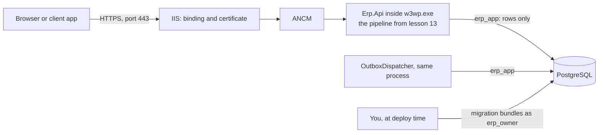

# Lesson 15 — Deploy to IIS: The App Goes to Work

Good day, developer! Until now, our ERP has lived on your machine, started by `dotnet run` and fed by a
database full of test users. Today it moves to a real Windows server, behind IIS, where a business can
use it every day. We'll build a release, prepare the server, migrate the database the safe way, and meet
our first real user. About three hours, most of it waiting for installers. Are you ready? Let's begin!

## What we'll build

| Piece | Where it lives |
|---|---|
| A first admin, created from configuration on a fresh install | The Identity module |
| A release: the published app, plus one migration bundle per module | `release/` on your machine, then `C:\deploy\erp` on the server |
| IIS and the .NET Hosting Bundle | The server |
| The `erp` database with its two accounts from [lesson 22](22-security-hardening.md) | PostgreSQL, on the server |
| An app pool that never falls asleep, holding the app's settings | IIS |
| A site with HTTPS | IIS, serving `C:\inetpub\erp` |
| A routine for deploying again | Five PowerShell lines |

## Why we build it this way

The obvious way to deploy is to copy your `bin` folder to the server, turn `MigrateOnStartup` on, connect as
`postgres`, and type the settings into `web.config`. It works on the first day. Then it starts to hurt.

The app migrates on every start, so a routine restart at 3 a.m. can run a migration nobody is watching, and
the running app needs a database account that can drop tables. Every `dotnet publish` writes a fresh
`web.config`, so your settings vanish on the next deploy. And IIS, left on its defaults, stops an idle app
after twenty minutes, taking the outbox dispatcher from [lesson 12](12-events-outbox.md) with it.

So we split the work by who does it, and when:

| Job | Done by | As |
|---|---|---|
| Change the schema | You, at deploy time, with the migration bundles | `erp_owner` |
| Serve requests and deliver events | The app, all day | `erp_app` |
| Hold the settings | The IIS app pool, outside the deploy folder | — |

To remember it easily: build on your machine, migrate as the owner, run as the app.

One more thing to know before we start. IIS was built long before .NET 10 and can't run it on its own. The
**Hosting Bundle** installs a small IIS module, the **ASP.NET Core Module (ANCM)**, which starts our app
inside IIS's own worker process, `w3wp.exe`, and hands it every request. That's called **in-process
hosting**. IIS owns the address, the certificate and the process; from the middleware pipeline down,
everything is the app you already know.

## 1. The first admin

Here's a problem we haven't met yet. On your machine, the development seed creates three users. A real
install has no seed, and in [lesson 05](05-sign-in.md) we blocked `/auth/register` on purpose. So a fresh
install has no users, and no way to make one.

The fix is a setting that's read once. If `InitialAdmin:Email` and `InitialAdmin:Password` are set, and
the database has no users at all, the app creates that user as an Admin when it starts:

```csharp
// src/Modules/Identity/Erp.Modules.Identity/Infrastructure/InitialAdmin.cs
using Erp.Shared.BuildingBlocks;
using Microsoft.AspNetCore.Identity;
using Microsoft.EntityFrameworkCore;
using Microsoft.Extensions.Configuration;
using Microsoft.Extensions.DependencyInjection;
using Microsoft.Extensions.Hosting;
using Microsoft.Extensions.Logging;

namespace Erp.Modules.Identity.Infrastructure;

// A fresh install has no users and self sign-up is blocked, so the first admin comes from configuration.
// It only acts while there are no users at all, so a forgotten setting can't recreate an account later.
internal sealed class InitialAdmin(IServiceScopeFactory scopes, IConfiguration config, ILogger<InitialAdmin> log)
    : IHostedService
{
    public async Task StartAsync(CancellationToken ct)
    {
        var email = config["InitialAdmin:Email"];
        var password = config["InitialAdmin:Password"];
        if (string.IsNullOrEmpty(email) || string.IsNullOrEmpty(password)) return;

        await using var scope = scopes.CreateAsyncScope();
        var users = scope.ServiceProvider.GetRequiredService<UserManager<AppUser>>();
        if (await users.Users.AnyAsync(ct))
        {
            log.LogWarning("InitialAdmin is set, but users already exist, so it was ignored. Remove the setting.");
            return;
        }

        var admin = new AppUser { UserName = email, Email = email, EmailConfirmed = true };
        var result = await users.CreateAsync(admin, password);
        if (result.Succeeded)
            result = await users.AddToRoleAsync(admin, Roles.Admin);
        if (!result.Succeeded)
            throw new InvalidOperationException(
                "The initial admin was not created: " + string.Join("; ", result.Errors.Select(e => e.Description)));

        log.LogInformation("Initial admin {Email} created. Remove the InitialAdmin settings.", email);
    }

    public Task StopAsync(CancellationToken ct) => Task.CompletedTask;
}
```

An `IHostedService` is the simpler parent of the `BackgroundService` from lesson 11: ASP.NET Core calls
`StartAsync` once as the app starts, and `StopAsync` once as it stops. Three choices here are deliberate:

| Choice | Why |
|---|---|
| Through `UserManager`, never SQL | Identity hashes the password and applies the password policy, exactly as for every other user |
| Only when there are **no users at all** | Someone forgets to remove the setting, and a year later deletes that account. It must not come back with a password sitting in a config file |
| A bad password stops the app from starting | A password shorter than 12 characters fails the policy. Better a loud failure on install day than an install nobody can sign in to |

Register it at the end of `AddIdentityModule`, after `AddDataProtection()`:

```csharp
services.AddHostedService<InitialAdmin>();
```

And list the setting, empty, in `appsettings.json`, so whoever installs the app can see it exists:

```json
"InitialAdmin": { "Email": "", "Password": "" }
```

Now a test that installs the app the way a customer will: its own empty database, no seed, only the two
settings. The test factory from [lesson 13](13-testing.md) already knows how to drop a database; let's
let it drop any database, not just its own.

Before, in `CustomWebAppFactory`:

```csharp
private static void DropTestDatabase()
{
    var target = new NpgsqlConnectionStringBuilder(TestConnectionString);
    var admin = new NpgsqlConnectionStringBuilder(TestConnectionString) { Database = "postgres", Pooling = false };
```

After:

```csharp
public static void DropDatabase(string connectionString)
{
    var target = new NpgsqlConnectionStringBuilder(connectionString);
    var admin = new NpgsqlConnectionStringBuilder(connectionString) { Database = "postgres", Pooling = false };
```

and the constructor calls `DropDatabase(TestConnectionString)`. Then the new test file:

```csharp
// tests/Erp.Integration.Tests/FirstRunTests.cs
using System.Net;
using System.Net.Http.Json;
using AwesomeAssertions;
using Erp.Shared.BuildingBlocks;
using Microsoft.AspNetCore.Hosting;
using Microsoft.AspNetCore.Mvc.Testing;
using Npgsql;

namespace Erp.Integration.Tests;

// A production install: its own empty database, no development users, only the InitialAdmin settings.
public sealed class FirstRunFactory : WebApplicationFactory<Program>
{
    public const string AdminEmail = "owner@company.test";
    public const string AdminPassword = "a long first-run password";

    private static readonly string ConnectionString =
        new NpgsqlConnectionStringBuilder(CustomWebAppFactory.TestConnectionString) { Database = "erp_test_first_run" }
            .ConnectionString;

    public FirstRunFactory() => CustomWebAppFactory.DropDatabase(ConnectionString);

    protected override void ConfigureWebHost(IWebHostBuilder builder)
    {
        builder.UseEnvironment("Development");
        builder.UseSetting("ConnectionStrings:ErpDb", ConnectionString);
        builder.UseSetting("Database:SeedDevelopmentData", "false");
        builder.UseSetting("InitialAdmin:Email", AdminEmail);
        builder.UseSetting("InitialAdmin:Password", AdminPassword);
        builder.UseSetting("ApiKeys:tests", CustomWebAppFactory.TestApiKey);
    }

    protected override void ConfigureClient(HttpClient client)
    {
        client.DefaultRequestHeaders.Add("X-Api-Key", CustomWebAppFactory.TestApiKey);
        base.ConfigureClient(client);
    }
}

// The least-privilege roles can't create a database, so this one only runs against the default superuser.
public sealed class OwnDatabaseFactAttribute : FactAttribute
{
    public OwnDatabaseFactAttribute()
    {
        if (Environment.GetEnvironmentVariable("ERP_TEST_DB_OWNER") is not null)
            Skip = "Needs to create its own database.";
    }
}

public class FirstRunTests(FirstRunFactory factory) : IClassFixture<FirstRunFactory>
{
    private sealed record Tokens(string AccessToken);
    private sealed record Me(long Id, string Username, string Role);

    [OwnDatabaseFact]
    public async Task A_fresh_install_gets_its_first_admin_from_configuration()
    {
        var client = factory.CreateClient();

        var login = await client.PostAsJsonAsync("/auth/login",
            new { email = FirstRunFactory.AdminEmail, password = FirstRunFactory.AdminPassword });
        login.StatusCode.Should().Be(HttpStatusCode.OK);

        var token = (await login.Content.ReadFromJsonAsync<Tokens>())!.AccessToken;
        client.DefaultRequestHeaders.Authorization = new("Bearer", token);
        var me = await client.GetFromJsonAsync<Me>("/auth/me");
        me!.Role.Should().Be(Roles.Admin);
    }
}
```

It still uses the Development environment, because that's what turns on migrating at startup for tests;
`SeedDevelopmentData` is switched off, so the only user who can exist is the one from `InitialAdmin`. The
class sits outside the `Integration` collection because it has a database of its own, so it can run
alongside the others. And when the suite runs as the least-privilege accounts from lesson 14, this one test
is reported as skipped, because `erp_owner` isn't allowed to create databases.

Run `dotnet test`: now 25 integration tests pass.

## 2. Build the release

Everything from here on happens in two places: your machine (Git Bash, like the rest of the course) and
the server (an elevated PowerShell). Each step says which.

On your machine, from the solution folder:

```bash
dotnet publish src/Erp.Api -c Release -o release/app

for m in Identity Sales Inventory; do
  dotnet ef migrations bundle --configuration Release \
    --project src/Modules/$m/Erp.Modules.$m --startup-project src/Modules/$m/Erp.Modules.$m \
    --output release/migrations/migrate-$m.exe --force
done

cp deploy/postgres/create-roles.sql release/
```

The standard `.gitignore` already ignores `release/`, so none of it ends up in Git.

`dotnet publish` compiles the app in Release mode and gathers everything it needs to run into one folder.
That folder is the whole app. It's **framework-dependent**: it expects .NET 10 to be installed on the
server, and the Hosting Bundle will put it there. When Microsoft patches .NET, one update on the server fixes
the app, with no rebuild.

A **migration bundle** is new. It's a single `.exe` that contains one module's migrations, built by the same
`dotnet ef` tool you've used since [lesson 04](04-database.md). On the server, you run it with a connection
string, and it applies whatever migrations that database hasn't had yet, then stops. Run it twice and the
second run does nothing, so it's safe on every deploy. We get three, because each module has its own
DbContext and its own migration history. They don't depend on each other: no foreign key crosses a schema.

Look inside `release/app`, and you'll find a `web.config` you never wrote:

```xml
<?xml version="1.0" encoding="utf-8"?>
<configuration>
  <location path="." inheritInChildApplications="false">
    <system.webServer>
      <handlers>
        <add name="aspNetCore" path="*" verb="*" modules="AspNetCoreModuleV2" resourceType="Unspecified" />
      </handlers>
      <aspNetCore processPath="dotnet" arguments=".\Erp.Api.dll" stdoutLogEnabled="false" stdoutLogFile=".\logs\stdout" hostingModel="inprocess" />
    </system.webServer>
  </location>
</configuration>
```

`dotnet publish` writes it, and it says only two things to IIS: send every request to ANCM, and here's how
to start the app. If you came from WebForms, this is the biggest habit to unlearn. `web.config` used to
hold everything: connection strings, app settings, authentication. Now it holds none of that. The app reads
its settings from `appsettings.json` and environment variables, and a `<connectionStrings>` section in here
would be silently ignored. It's also rewritten on every publish, so anything you add to it is gone on the
next deploy.

Copy the whole `release` folder to the server as `C:\deploy\erp`. How is up to you: a network share, a
zip over Remote Desktop, a build agent.

## 3. Prepare the server: IIS, then the Hosting Bundle

On the server, in an elevated PowerShell (right-click, *Run as administrator*). This lesson assumes Windows
Server 2019 or later.

```powershell
Install-WindowsFeature Web-Server, Web-Mgmt-Console, Web-Scripting-Tools, Web-AppInit
```

| Feature | Why we need it |
|---|---|
| `Web-Server` | IIS itself |
| `Web-Mgmt-Console` | IIS Manager, for when you'd rather click than type |
| `Web-Scripting-Tools` | The `WebAdministration` PowerShell module that steps 6 to 8 use |
| `Web-AppInit` | Application Initialization, so IIS can start the app before the first request arrives |

If this server once hosted a WebForms app, you'll also see ASP.NET 4.x features installed. Our app doesn't
use them; ANCM starts .NET 10 itself. Leave them alone if other sites need them, and don't add them for
ours.

Then the **Hosting Bundle**. From <https://dotnet.microsoft.com/download/dotnet/10.0>, download the
"ASP.NET Core Runtime, Hosting Bundle" for Windows (`dotnet-hosting-10.0.x-win.exe`). It installs the .NET
runtime and ANCM. Run it, then restart IIS so it loads the new module:

```powershell
net stop was /y
net start w3svc
```

One thing to watch out for: the order. **IIS first, Hosting Bundle second.** The bundle registers ANCM
*into* IIS, and if IIS isn't there yet, it quietly skips that part. If you got the order wrong, or the
server had .NET before it had IIS, run the installer again with `/repair`.

Let's prove the server is ready:

```powershell
Test-Path "$env:ProgramFiles\IIS\Asp.Net Core Module\V2\aspnetcorev2.dll"      # True
dotnet --list-runtimes | Select-String 'Microsoft.AspNetCore.App 10\.'          # one line
Get-Website | Format-Table Name, State, Bindings                                # what's already here
```

## 4. The database

Install PostgreSQL 16 or later on the server, with the Windows installer from
<https://www.postgresql.org/download/windows/>. It's the same build `winget` gave you in lesson 04, with a
wizard. Choose a strong password for the `postgres` superuser and keep it somewhere safe; after today, you'll
rarely need it.

Now the two accounts from lesson 13. They need real passwords this time, so let's generate them:

```powershell
function New-Secret {
    $bytes = New-Object byte[] 24
    [Security.Cryptography.RandomNumberGenerator]::Create().GetBytes($bytes)
    ([BitConverter]::ToString($bytes) -replace '-').ToLower()
}
$ownerPassword = New-Secret
$appPassword   = New-Secret
$ownerPassword; $appPassword        # store both in your password manager now
```

Hex digits only, so the passwords are safe inside a connection string and on the command line. Then run
the role script once, as the superuser (it asks for the `postgres` password):

```powershell
& 'C:\Program Files\PostgreSQL\18\bin\psql.exe' -U postgres `
    -v db=erp -v owner_password=$ownerPassword -v app_password=$appPassword `
    -f C:\deploy\erp\create-roles.sql
```

You should see two `CREATE ROLE`s, a `CREATE DATABASE`, and four `ALTER DEFAULT PRIVILEGES`.

If PostgreSQL runs on a separate server, three more things are needed. Its `postgresql.conf` must listen
on the network (`listen_addresses`). Its `pg_hba.conf` must accept the web server, for example
`hostssl erp erp_owner,erp_app 10.0.0.5/32 scram-sha-256`. And its firewall should open port 5432 to the
web server only. Then add `;SSL Mode=Require` to both connection strings below. Now, let's be honest about
that last part: `Require` encrypts the connection but doesn't check who's on the other end. The strict
version is `VerifyFull` with the database server's certificate authority installed on the web server.

## 5. Migrate, as the owner

On the server:

```powershell
$owner = "Host=localhost;Database=erp;Username=erp_owner;Password=$ownerPassword"
foreach ($m in 'Identity', 'Sales', 'Inventory') {
    & "C:\deploy\erp\migrations\migrate-$m.exe" --connection $owner
    if ($LASTEXITCODE -ne 0) { throw "migrate-$m failed" }
}
```

Each bundle prints the migrations it applies, then `Done.`:

```
Applying migration '20261105152745_InitialCreate'.
Applying migration '20261105152753_AddReadFunctions'.
Done.
```

On a brand-new database, each one also logs a `Failed executing DbCommand` for
`SELECT ... FROM sales."__EFMigrationsHistory"`. That's EF looking for its history table before creating
it. It's harmless.

The schemas, tables and SQL functions are now owned by `erp_owner`, and thanks to the default privileges
from lesson 13, `erp_app` can read and write their rows. That only works because the bundles ran as
`erp_owner`. Run them as `postgres`, and every object belongs to `postgres`, and `erp_app` gets
`permission denied` on its first query.

## 6. The app pool, and its settings

An **app pool** is the Windows process our app lives in, with its own identity. Let's create one and change
four of its defaults:

```powershell
Import-Module WebAdministration

New-WebAppPool -Name ErpApi
Set-ItemProperty IIS:\AppPools\ErpApi -Name managedRuntimeVersion -Value ''
Set-ItemProperty IIS:\AppPools\ErpApi -Name startMode -Value AlwaysRunning
Set-ItemProperty IIS:\AppPools\ErpApi -Name processModel.idleTimeout -Value ([TimeSpan]::Zero)
Set-ItemProperty IIS:\AppPools\ErpApi -Name recycling.periodicRestart.time -Value ([TimeSpan]::Zero)
```

| Setting | Default | Ours | Why |
|---|---|---|---|
| .NET CLR version | v4.0 | No Managed Code (`''`) | That setting loads the old .NET Framework into the process. We don't use it; ANCM loads .NET 10 |
| Start mode | OnDemand | AlwaysRunning | Start the process when IIS starts, not when the first request happens to arrive |
| Idle timeout | 20 minutes | Never | After 20 quiet minutes, IIS stops the process, and the outbox dispatcher with it |
| Regular recycle | Every 29 hours | Never | A habit from older frameworks. A .NET 10 app doesn't need a scheduled restart |

The idle timeout is the one that matters most. The outbox never loses an event: when the process stops,
events wait safely in the outbox table. But they'd wait until somebody happened to make a request, and a
manager's approval shouldn't depend on that.

Now the settings. They go into the app pool as **environment variables**. IIS keeps them in its own
configuration, `applicationHost.config`, outside the deploy folder, so publishing again never touches them.
Environment variable names can't contain `:`, so .NET reads a double underscore as one:
`ConnectionStrings__ErpDb` is `ConnectionStrings:ErpDb`.

Two small helpers make this repeatable:

```powershell
$poolVariables = "system.applicationHost/applicationPools/add[@name='ErpApi']/environmentVariables"

function Remove-PoolVariable($name) {
    Remove-WebConfigurationProperty -PSPath 'MACHINE/WEBROOT/APPHOST' -Filter $poolVariables `
        -Name '.' -AtElement @{ name = $name } -ErrorAction SilentlyContinue
}

function Set-PoolVariable($name, $value) {
    Remove-PoolVariable $name
    Add-WebConfigurationProperty -PSPath 'MACHINE/WEBROOT/APPHOST' -Filter $poolVariables `
        -Name '.' -Value @{ name = $name; value = $value }
}
```

And the settings themselves:

```powershell
$webKey = New-Secret
$webKey                              # into the password manager, next to the other two

Set-PoolVariable 'ConnectionStrings__ErpDb' "Host=localhost;Database=erp;Username=erp_app;Password=$appPassword"
Set-PoolVariable 'ApiKeys__web'             $webKey
Set-PoolVariable 'InitialAdmin__Email'      'you@yourcompany.ph'
Set-PoolVariable 'InitialAdmin__Password'   'a long password you will change in a minute'
```

| Setting | What it's for |
|---|---|
| `ConnectionStrings__ErpDb` | The app connects as `erp_app`: rows only |
| `ApiKeys__web` | The key a client app sends as `X-Api-Key` (lesson 13) |
| `InitialAdmin__Email`, `InitialAdmin__Password` | The first admin. Removed again as soon as you've signed in |

And just as important, what's *not* here:

| Not set | Why |
|---|---|
| `ASPNETCORE_ENVIRONMENT` | Unset means **Production**: no Swagger, no development seed, bland 500 responses |
| `ConnectionStrings__ErpDbMigrations` | The app never migrates in production. The owner's password only ever appears in step 5 |
| `Database__MigrateOnStartup` | Off in `appsettings.json` since lesson 04, and it stays off |
| `Cors__AllowedOrigins__0` | Only needed if a browser app on *another* address calls the API |
| `OTEL_EXPORTER_OTLP_ENDPOINT` | Where to send logs, traces and metrics. Lesson 16 picks a destination |

Now, let's be honest about where these live. A password in `applicationHost.config` is still a password in
a file on the server. Only administrators can read that file, and it's never part of a deploy or of Git,
which is a real step up from `web.config`. A dedicated secret store is stronger still, and lesson 16
points to one.

## 7. The site

The live site gets its own folder, separate from the release in `C:\deploy\erp`. That separation is what
makes redeploying safe in step 10.

```powershell
New-Item -ItemType Directory C:\inetpub\erp -Force | Out-Null
Copy-Item C:\deploy\erp\app\* C:\inetpub\erp -Recurse -Force
icacls C:\inetpub\erp /grant 'IIS AppPool\ErpApi:(OI)(CI)RX' /T | Out-Null

New-Website -Name ErpApi -PhysicalPath C:\inetpub\erp -ApplicationPool ErpApi `
    -HostHeader erp.yourcompany.ph -Port 80
Set-ItemProperty IIS:\Sites\ErpApi -Name applicationDefaults.preloadEnabled -Value $true
```

`IIS AppPool\ErpApi` is a Windows account that exists because the pool exists, and it's who the app runs
as. It gets read and execute on its folder, and nothing else; it never writes there. The **host header**
means this site answers only for `erp.yourcompany.ph`, so it can share port 80 with whatever else lives on
the server. `preloadEnabled` is the other half of `AlwaysRunning`: together, they start the app as soon as
IIS starts.

With the site created, the app starts for the first time. It finds no users, so it creates your first
admin. Easy, right?

## 8. HTTPS, and two headers IIS adds

You need a certificate for `erp.yourcompany.ph`: from your company's certificate authority, from a
commercial one, or free from Let's Encrypt through a tool like win-acme, which also renews it for you. With
the certificate as a `.pfx` file:

```powershell
$cert = Import-PfxCertificate -FilePath C:\deploy\erp.pfx -CertStoreLocation Cert:\LocalMachine\My `
    -Password (Read-Host 'Certificate password' -AsSecureString)

New-WebBinding -Name ErpApi -Protocol https -Port 443 -HostHeader erp.yourcompany.ph -SslFlags 1
(Get-WebBinding -Name ErpApi -Protocol https).AddSslCertificate($cert.Thumbprint, 'My')
```

`SslFlags 1` is SNI, which lets several HTTPS sites share port 443. Keep the port 80 binding: a visitor who
types `http://` reaches the app, `UseHttpsRedirection` from lesson 13 sends them to `https://`, and HSTS
makes their browser go straight to HTTPS from then on. IIS now does the encryption, so the app never sees
the certificate at all.

In lesson 13 we stopped Kestrel announcing itself in a `Server` header. Under IIS, Kestrel isn't the server;
IIS is, and it adds `Server: Microsoft-IIS/10.0` and `X-Powered-By: ASP.NET` to every response. Both are
server-wide settings, made once:

```powershell
Set-WebConfigurationProperty -PSPath 'MACHINE/WEBROOT/APPHOST' -Filter system.webServer/security/requestFiltering `
    -Name removeServerHeader -Value $true
Remove-WebConfigurationProperty -PSPath 'MACHINE/WEBROOT/APPHOST' -Filter system.webServer/httpProtocol/customHeaders `
    -Name '.' -AtElement @{ name = 'X-Powered-By' }
```

## 9. When it breaks: read the number

IIS failures look mysterious, but each status code is a diagnosis. Don't guess; read the number.

| You see | It means | Do this |
|---|---|---|
| **500.19** | IIS can't understand `web.config`: ANCM isn't installed | Install or repair the Hosting Bundle (step 3) |
| **500.30** | The app threw while starting. This one is ours | Read the Event Log, below. Usually a wrong connection string, an unreachable database, or an `InitialAdmin` password under 12 characters |
| **500.31** | The .NET runtime the app needs isn't on the server | Install the .NET 10 Hosting Bundle |
| **503** for everything | The app crashed five times in five minutes, so IIS stopped the pool | Fix the 500.30 cause, then `Start-WebAppPool ErpApi` |
| **401** on every call | No `X-Api-Key`, or the wrong one | Check `ApiKeys__web` |
| `/health/ready` says **Unhealthy** | The app is up, the database isn't reachable | Connection string, PostgreSQL service, `pg_hba.conf`, firewall |
| **500** with `permission denied` in the log | The migrations ran as someone other than `erp_owner` | On a fresh install, drop the database and repeat steps 4 and 5 |

Where to look, in order:

1. **The Event Log.** *Event Viewer, Windows Logs, Application.* ANCM writes startup failures there under
   the source *IIS AspNetCore Module V2*, with the real exception. The app's own warnings and errors land in
   the same log.
2. **The stdout log**, when the Event Log isn't enough. In the *live* site's `web.config`, set
   `stdoutLogEnabled="true"`, then give the pool a folder to write to:

   ```powershell
   New-Item -ItemType Directory C:\inetpub\erp\logs | Out-Null
   icacls C:\inetpub\erp\logs /grant 'IIS AppPool\ErpApi:(OI)(CI)M' | Out-Null
   ```

   Turn it off again when you're done. That file never rotates, and over a few months it would fill the
   disk. The next deploy resets `web.config` anyway.

## 10. Deploying again

The first deploy was mostly setup. A new version is much shorter: build a new `release` on your machine
(step 2), copy it over `C:\deploy\erp`, and on the server:

```powershell
$ownerPassword = Read-Host 'erp_owner password'
$owner = "Host=localhost;Database=erp;Username=erp_owner;Password=$ownerPassword"

Set-Content C:\inetpub\erp\app_offline.htm '<h1>The ERP is being updated. Back in a minute.</h1>'
foreach ($m in 'Identity', 'Sales', 'Inventory') {
    & "C:\deploy\erp\migrations\migrate-$m.exe" --connection $owner
    if ($LASTEXITCODE -ne 0) { throw "migrate-$m failed; the site stays offline" }
}
Copy-Item C:\deploy\erp\app\* C:\inetpub\erp -Recurse -Force
Remove-Item C:\inetpub\erp\app_offline.htm
Invoke-RestMethod https://erp.yourcompany.ph/health/ready
```

`app_offline.htm` is a file name ANCM watches for. When it appears, ANCM stops the app gracefully and shows
that page to everyone. With the app stopped, three good things happen: its DLLs are no longer locked, so the
copy can't fail halfway; no request runs against a schema that's halfway through migrating; and the outbox
dispatcher finishes its batch and stops. When the file goes away, the next request starts the new version,
and the health check is that request. Any events raised just before the update waited in the outbox table,
and go out now.

`Read-Host` keeps the owner's password out of your PowerShell history. Steps 3, 4, 6, 7 and 8 never repeat.

## How a request flows



Everything to the right of ANCM is the app you've been building since lesson 01, unchanged. IIS decided
where it runs, not how it works. The only code we wrote today was the first admin, and that's a product
feature, not a hosting one.

## Mistakes to avoid

- Running the migration bundles as `postgres`. Everything they create belongs to `postgres`, and `erp_app`
  can't touch it.
- Setting `ASPNETCORE_ENVIRONMENT` to `Development` on a server. It turns on migrating and seeding, and the
  seed creates three users whose password is printed in this course.
- Typing settings into the published `web.config`. The next publish erases them.
- Leaving the idle timeout at 20 minutes. Events wait for a visitor instead of going out.
- Leaving `InitialAdmin__Password` in the app pool after you've signed in.
- Installing the Hosting Bundle before IIS.
- Copying a new version over a running site, without `app_offline.htm`.
- Leaving stdout logging on.

## Let's run it!

From your own machine, in PowerShell (the server works too, if the name resolves there):

```powershell
$base = 'https://erp.yourcompany.ph'
$key  = @{ 'X-Api-Key' = '<your ApiKeys__web value>' }

Invoke-RestMethod "$base/health/ready"                          # Healthy
try { Invoke-RestMethod "$base/sales-orders" } catch { $_.Exception.Response.StatusCode }   # Unauthorized
```

Sign in as your first admin:

```powershell
$body  = @{ email = 'you@yourcompany.ph'; password = 'a long password you will change in a minute' } | ConvertTo-Json
$login = Invoke-RestMethod "$base/auth/login" -Method Post -Headers $key -ContentType 'application/json' -Body $body
$auth  = $key + @{ Authorization = "Bearer $($login.accessToken)" }

Invoke-RestMethod "$base/auth/me" -Headers $auth
```

```
id username           role
-- --------           ----
 1 you@yourcompany.ph Admin
```

Change that password right away, through Identity's own endpoint from lesson 05:

```powershell
$change = @{ oldPassword = 'a long password you will change in a minute'; newPassword = '<your real password>' } | ConvertTo-Json
Invoke-RestMethod "$base/auth/manage/info" -Method Post -Headers $auth -ContentType 'application/json' -Body $change
```

Then, on the server, remove the two settings and restart the pool:

```powershell
Remove-PoolVariable 'InitialAdmin__Email'
Remove-PoolVariable 'InitialAdmin__Password'
Restart-WebAppPool ErpApi
```

Back on your machine, the token you got *before* the restart still works:

```powershell
Invoke-RestMethod "$base/auth/me" -Headers $auth
```

That's lesson 13's sign-in keys at work: they live in the database, so a restart doesn't sign anyone out.
While you're there, the Event Log shows one warning from the first start, *No XML encryptor configured*.
It's telling the truth: those keys are stored in the database without extra encryption. Lesson 16 has it on
the checklist.

Now the protections:

```powershell
(Invoke-WebRequest "$base/health/live" -UseBasicParsing).Headers
```

You'll find `Strict-Transport-Security`, `X-Frame-Options: DENY` and an `X-Trace-Id`, and no `Server` or
`X-Powered-By`. Finally, `Invoke-RestMethod "$base/sales-orders" -Headers $auth` returns an empty page:
`totalCount` is 0. A real install starts with no customers and no items. The screens to add them are the
next part of the product.

## Let's check!

1. Why do migrations run as a deploy step instead of when the app starts?
2. What goes wrong if the migration bundles run as `postgres` instead of `erp_owner`?
3. Why do the settings live in the app pool and not in `web.config`?
4. What does IIS's idle timeout do to the outbox, and what happens to events raised while the app is
   stopped?
5. Why does `InitialAdmin` only act when there are no users at all?
6. A server answers 500.30. Where do you look first, and what are the usual causes?

And that's where this lesson ends. Your ERP is running on a real server, over HTTPS, as an account that
can't drop a table, with a real admin who chose their own password. Next time, in the last lesson, we walk
the production checklist: what's done, what's left, and what you'd add as the business grows. Good luck,
developer!

---

← [Lesson 13 — Testing](13-testing.md) · Next: [Lesson 25 — Production checklist](25-production-checklist.md) →
