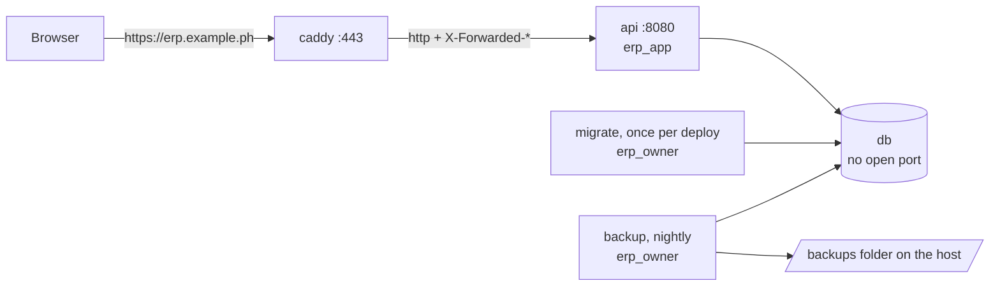

# Lesson 24 — Deploying with Podman: The Whole ERP on One Server

Good day, developer! Everything works on your machine. Today it goes to work for real: on a server, with
HTTPS, its own database, migrations that run before the app starts, and a backup every night. We'll package
it as container images and run them with **Podman**, which you met in [lesson 12](12-containers-ci.md), so
the server needs exactly one thing installed, and "it works on my machine" becomes "it works on every
machine". By the end, one command installs the whole ERP, and the same command upgrades
it. About two hours. Are you ready? Let's begin!

## What we'll build

| Piece | What it does |
|---|---|
| The **first admin** | A fresh install has no users; one comes from configuration, once |
| A **Dockerfile** | Builds two images: the app, and a one-shot migrator |
| A **Compose** file | Runs five containers together: database, migrator, app, HTTPS, backups |
| **Caddy** | HTTPS with a real certificate, obtained and renewed by itself |
| **Secrets and settings** | One private `.env` file, and the data-protection certificate as a secret |
| **Backups** | A `pg_dump` every night, kept for two weeks |

## Why we build it this way

### Why containers

Without containers, a server needs the right .NET runtime, the right PostgreSQL, the right fonts for the
invoice PDFs, a reverse proxy configured by hand, and someone who remembers how it was all set up. Two
servers set up a year apart are never quite the same.

You already know the cure from [lesson 12](12-containers-ci.md): an image carries everything it needs, and a
container is a running copy of it. Remember the shipping container packed at the factory: today we pack our
own. The server needs only Podman; everything else arrives inside the images.

### Why Compose, and not Kubernetes

Our ERP is one app and one database for one company. **Compose** runs a handful of containers on one machine
from a single file, starts them in the right order, and restarts them if they stop. That's all a business of
fifty people needs. Kubernetes is built for hundreds of machines and the teams to run them; requiring it would
add a full-time job to every install. If a buyer outgrows one server, the same images run anywhere.

### Podman on the server, and Docker works too

The server runs **Podman**, for the reasons from lesson 12: free for any use (Apache-2.0), no background
service running as root, and rootless containers, so a container that's broken into gets the rights of one
ordinary user, not of the whole server. `podman compose` reads our Compose file using the standard
`docker-compose` program (Apache-2.0) behind the scenes.

The files we write today, the `Dockerfile` and `compose.yaml`, follow the open standards, so a buyer who
already runs **Docker Engine** (also free, Apache-2.0) types `podman compose` instead of `podman compose`, and
nothing else changes. What we avoid is requiring **Docker Desktop** on a server: it's a developer tool, and
larger companies pay for it.

Now, let's be honest about the cost here: rootless has two small consequences on a server. An ordinary user
may not open ports below 1024, and Caddy needs 80 and 443, so the install allows that once. And a user's
containers stop when that user logs out, unless the server is told to keep them, which the install also does.
Both are one command, in step 5.

### Migrations as a step, not at startup

In development, the app migrates its own database when it starts (lesson 05). In production that's the
wrong place: a migration that fails would crash the app on a routine restart, and the app would need rights
to change tables, which lesson 23 took away. So migrations run as their own container, as `erp_owner`,
*before* the app starts, and the app starts only if they succeeded.

## 1. The first admin

A fresh install has no users. The development seed doesn't run in production, and in lesson 06 we blocked
`/auth/register` on purpose. So who signs in first?

The answer is a setting that's read once. If `InitialAdmin:Email` and `InitialAdmin:Password` are set, and
there are no users at all, the app creates that admin as it starts:

```csharp
// src/Modules/Identity/Erp.Modules.Identity/Infrastructure/InitialAdmin.cs
using Erp.Shared.BuildingBlocks;
using Microsoft.AspNetCore.Identity;
using Microsoft.EntityFrameworkCore;
using Microsoft.Extensions.Configuration;
using Microsoft.Extensions.DependencyInjection;
using Microsoft.Extensions.Hosting;
using Microsoft.Extensions.Logging;

namespace Erp.Modules.Identity.Infrastructure;

// A fresh install has no users and self sign-up is blocked, so the first admin comes from configuration.
// It only acts while there are no users at all, so a forgotten setting can't recreate an account later.
internal sealed class InitialAdmin(IServiceScopeFactory scopes, IConfiguration config, ILogger<InitialAdmin> log)
    : IHostedService
{
    public async Task StartAsync(CancellationToken ct)
    {
        var email = config["InitialAdmin:Email"];
        var password = config["InitialAdmin:Password"];
        if (string.IsNullOrEmpty(email) || string.IsNullOrEmpty(password)) return;

        await using var scope = scopes.CreateAsyncScope();
        var users = scope.ServiceProvider.GetRequiredService<UserManager<AppUser>>();
        if (await users.Users.AnyAsync(ct))
        {
            log.LogWarning("InitialAdmin is set, but users already exist, so it was ignored. Remove the setting.");
            return;
        }

        var admin = new AppUser { UserName = email, Email = email, EmailConfirmed = true, FullName = "Administrator" };
        var result = await users.CreateAsync(admin, password);
        if (result.Succeeded)
            result = await users.AddToRoleAsync(admin, Roles.Admin);
        if (!result.Succeeded)
            throw new InvalidOperationException(
                "The initial admin was not created: " + string.Join("; ", result.Errors.Select(e => e.Description)));

        log.LogInformation("Initial admin {Email} created. Remove the InitialAdmin settings.", email);
    }

    public Task StopAsync(CancellationToken ct) => Task.CompletedTask;
}
```

An `IHostedService` is the simpler parent of lesson 13's `BackgroundService`: ASP.NET Core calls
`StartAsync` once as the app starts, and `StopAsync` once as it stops. Three choices here are deliberate:

| Choice | Why |
|---|---|
| Through `UserManager`, never SQL | Identity hashes the password and applies the password policy, exactly as for every other user |
| Only when there are **no users at all** | Someone forgets to remove the setting, and a year later deletes that account. It must not come back with a password sitting in a config file |
| A bad password stops the app from starting | A password shorter than 12 characters fails the policy. Better a loud failure on install day than an install nobody can sign in to |

Register it at the end of `AddIdentityModule` with `services.AddHostedService<InitialAdmin>();`, and list the
setting, empty, in `appsettings.json`, so whoever installs the app can see it exists:

```json
"InitialAdmin": { "Email": "", "Password": "" }
```

A test installs the app the way a customer will: its own empty PostgreSQL server, no seed, only the two
settings. Since [lesson 12](12-containers-ci.md), that's one line: a second container of its own.

```csharp
using System.Net;
using System.Net.Http.Json;
using AwesomeAssertions;
using Erp.Shared.BuildingBlocks;
using Microsoft.AspNetCore.Hosting;
using Microsoft.AspNetCore.Mvc.Testing;
using Testcontainers.PostgreSql;

namespace Erp.Integration.Tests;

// A production install: its own empty server, no development users, only the InitialAdmin settings.
public sealed class FirstRunFactory : WebApplicationFactory<Program>, IAsyncLifetime
{
    public const string AdminEmail = "owner@company.test";
    public const string AdminPassword = "a long first-run password";

    private readonly PostgreSqlContainer _postgres = TestDatabase.Container().Build();

    public Task InitializeAsync() => _postgres.StartAsync();

    async Task IAsyncLifetime.DisposeAsync()
    {
        await DisposeAsync();
        await _postgres.DisposeAsync();
    }

    protected override void ConfigureWebHost(IWebHostBuilder builder)
    {
        builder.UseEnvironment("Development");
        builder.UseSetting("ConnectionStrings:ErpDb", _postgres.GetConnectionString());
        builder.UseSetting("Database:SeedDevelopmentData", "false");
        builder.UseSetting("InitialAdmin:Email", AdminEmail);
        builder.UseSetting("InitialAdmin:Password", AdminPassword);
    }
}

public class FirstRunTests(FirstRunFactory factory) : IClassFixture<FirstRunFactory>
{
    private sealed record Tokens(string AccessToken);
    private sealed record Me(long Id, string Username, string Role);

    [Fact]
    public async Task A_fresh_install_gets_its_first_admin_from_configuration()
    {
        var client = factory.CreateClient();

        var login = await client.PostAsJsonAsync("/api/auth/login",
            new { email = FirstRunFactory.AdminEmail, password = FirstRunFactory.AdminPassword });
        login.StatusCode.Should().Be(HttpStatusCode.OK);

        var token = (await login.Content.ReadFromJsonAsync<Tokens>())!.AccessToken;
        client.DefaultRequestHeaders.Authorization = new("Bearer", token);
        var me = await client.GetFromJsonAsync<Me>("/api/auth/me");
        me!.Role.Should().Be(Roles.Admin);
    }

    [Fact]
    public async Task A_fresh_install_has_no_development_users()
    {
        var login = await factory.CreateClient().PostAsJsonAsync("/api/auth/login",
            new { email = "admin@erp.local", password = CustomWebAppFactory.Password });
        login.StatusCode.Should().Be(HttpStatusCode.Unauthorized);
    }
}
```

It still uses the Development environment, because that's what turns on migrating at startup for tests;
`SeedDevelopmentData` is switched off, so the only user who can exist is the one from `InitialAdmin`. The
second test is the edge that matters as much: a production install must have *no* development users. If the
seed ever ran in production, `admin@erp.local` with a password from a public course would let anyone in.
The class sits outside the `Integration` collection, with a server of its own, so it runs alongside the
others.

## 2. The images

```dockerfile
# Dockerfile (at the solution root)
# syntax=docker/dockerfile:1
# Two images from one build: `app` (the ERP) and `migrate` (one-shot schema update, run before each app start).
# Both start from the same ASP.NET runtime image, so a server stores those layers once.

FROM mcr.microsoft.com/dotnet/sdk:10.0 AS build
ARG TARGETARCH
WORKDIR /src

# Restore first, from the project files only, so a code change doesn't re-download every package.
COPY Directory.Build.props Directory.Packages.props Erp.slnx ./
COPY .config/ .config/
COPY src/Shared/Erp.Shared.BuildingBlocks/*.csproj src/Shared/Erp.Shared.BuildingBlocks/
COPY src/Shared/Erp.Shared.Infrastructure/*.csproj src/Shared/Erp.Shared.Infrastructure/
COPY src/Modules/Identity/Erp.Modules.Identity/*.csproj src/Modules/Identity/Erp.Modules.Identity/
COPY src/Modules/Sales/Erp.Modules.Sales/*.csproj src/Modules/Sales/Erp.Modules.Sales/
COPY src/Modules/Sales/Erp.Modules.Sales.Contracts/*.csproj src/Modules/Sales/Erp.Modules.Sales.Contracts/
COPY src/Modules/Inventory/Erp.Modules.Inventory/*.csproj src/Modules/Inventory/Erp.Modules.Inventory/
COPY src/Modules/Inventory/Erp.Modules.Inventory.Contracts/*.csproj src/Modules/Inventory/Erp.Modules.Inventory.Contracts/
COPY src/Modules/Purchasing/Erp.Modules.Purchasing/*.csproj src/Modules/Purchasing/Erp.Modules.Purchasing/
COPY src/Modules/Invoicing/Erp.Modules.Invoicing/*.csproj src/Modules/Invoicing/Erp.Modules.Invoicing/
COPY src/Modules/Invoicing/Erp.Modules.Invoicing.Contracts/*.csproj src/Modules/Invoicing/Erp.Modules.Invoicing.Contracts/
COPY src/Erp.Web/*.csproj src/Erp.Web/
COPY src/Erp.Api/*.csproj src/Erp.Api/
RUN dotnet restore src/Erp.Api && dotnet tool restore

COPY src/ src/
RUN dotnet publish src/Erp.Api -c Release -o /out/app --no-restore

# One migration bundle per module (each has its own DbContext and history), built for this image's CPU.
RUN rid=linux-$([ "$TARGETARCH" = "arm64" ] && echo arm64 || echo x64) \
 && for m in Identity Sales Inventory Purchasing Invoicing; do \
      dotnet ef migrations bundle --configuration Release -r "$rid" \
        --project "src/Modules/$m/Erp.Modules.$m" --startup-project "src/Modules/$m/Erp.Modules.$m" \
        --output "/out/migrations/migrate-$m" --force || exit 1; \
    done

FROM mcr.microsoft.com/dotnet/aspnet:10.0 AS migrate
WORKDIR /migrations
COPY --from=build /out/migrations/ ./
COPY deploy/compose/migrate.sh ./
USER $APP_UID
ENTRYPOINT ["/bin/sh", "/migrations/migrate.sh"]

FROM mcr.microsoft.com/dotnet/aspnet:10.0 AS app
# The invoice PDF embeds a font; DejaVu Sans comes with the operating system image, not with this source.
RUN apt-get update \
 && apt-get install -y --no-install-recommends fonts-dejavu-core \
 && rm -rf /var/lib/apt/lists/*
WORKDIR /app
COPY --from=build /out/app/ ./
# Never root: the image's built-in unprivileged user.
USER $APP_UID
ENV ASPNETCORE_HTTP_PORTS=8080
EXPOSE 8080
ENTRYPOINT ["dotnet", "Erp.Api.dll"]
```

This is a **multi-stage build**: several `FROM` lines, each starting a stage. Let's walk through it.

| Part | Why |
|---|---|
| `sdk:10.0 AS build` | The full SDK, to compile. It's big (~800 MB), so it never ships: only what the later stages copy out of it does |
| Project files first, then `restore`, then the code | The image builder caches each step. Change a `.cs` file and the restore step is reused, so a rebuild takes seconds, not minutes |
| `dotnet publish` | Compiles the API *and* the Blazor app (lesson 01's project reference), into one folder |
| `dotnet ef migrations bundle` | A **migration bundle**: one small program per module that applies that module's migrations to a database, then exits. `dotnet tool restore` installed `dotnet-ef` from lesson 05's tool manifest. Five bundles, because each module has its own DbContext and history |
| `-r linux-x64` or `linux-arm64` | The bundle is built for the server's CPU. `TARGETARCH` is filled in by the image builder, so the same Dockerfile builds for an ordinary server or an ARM one |
| `aspnet:10.0 AS migrate` and `AS app` | Both final images start from the small runtime image, with no SDK. A server stores the shared layers once |
| `fonts-dejavu-core` | Lesson 20's PDF needs a font, and the Linux runtime image has none |
| `USER $APP_UID` | The runtime images come with an unprivileged user. Even if someone broke into the app, they wouldn't be root inside the container |
| Port 8080 | Ports below 1024 need root on Linux; the app doesn't. Caddy, in front of it, takes 80 and 443 |

The bundles and the app are **framework-dependent**: they use the .NET runtime that's already in the base
image, instead of carrying their own copy. A self-contained bundle is about 135 MB; this way it's a few
megabytes, and a .NET security patch arrives by rebuilding on the newest base image.

Two small files keep the build clean:

```text
# .dockerignore
# Only what the build needs: no build output, no tests, no local secrets.
**/bin/
**/obj/
**/.vs/
**/*.user
tests/
deploy/compose/secrets/
deploy/compose/backups/
deploy/compose/.env
release/
```

```text
# .gitattributes
# Scripts and configs that run inside Linux containers must keep Unix line endings, even on Windows.
*.sh text eol=lf
Caddyfile text eol=lf
*.sql text eol=lf
```

That second one prevents a classic Windows trap. Git on Windows can turn line endings into `\r\n`; a shell
script with `\r\n` fails inside Linux with the baffling `/bin/sh^M: bad interpreter`. `eol=lf` keeps them
Unix-style, whatever machine checks them out.

The migrator's script:

```sh
#!/bin/sh
# deploy/compose/migrate.sh
# Brings every module's schema up to date, as erp_owner, then exits. Safe to run on every deploy: each bundle
# applies only the migrations that database hasn't had yet.
set -e
for module in Identity Sales Inventory Purchasing Invoicing; do
    echo "== $module"
    "/migrations/migrate-$module" --connection "$ERP_OWNER_CONNECTION"
done
echo "All schemas are up to date."
```

`set -e` stops at the first failure, so a broken migration is never followed by the app starting on a
half-migrated database.

## 3. The stack

```yaml
# deploy/compose/compose.yaml
# The whole ERP on one container host. Settings and secrets come from .env next to this file (see .env.example).
#   podman compose up -d --build      first install, and every upgrade after it (podman compose works the same)
# The ",z" on each mounted file lets SELinux hosts (Fedora, RHEL) share it with the container; elsewhere it's ignored.
name: erp

services:
  db:
    image: postgres:18
    restart: unless-stopped
    environment:
      POSTGRES_PASSWORD: ${POSTGRES_PASSWORD:?Set POSTGRES_PASSWORD in .env}
      ERP_OWNER_PASSWORD: ${ERP_OWNER_PASSWORD:?Set ERP_OWNER_PASSWORD in .env}
      ERP_APP_PASSWORD: ${ERP_APP_PASSWORD:?Set ERP_APP_PASSWORD in .env}
      TZ: ${TZ:-Asia/Manila}
    volumes:
      - db-data:/var/lib/postgresql
      - ../postgres/create-roles.sql:/erp/create-roles.sql:ro,z
      - ./initdb:/docker-entrypoint-initdb.d:ro,z
    healthcheck:
      test: ["CMD-SHELL", "pg_isready --username postgres --dbname erp"]
      interval: 5s
      retries: 30
    # No ports: only the other containers reach the database.

  migrate:
    build: { context: ../.., target: migrate }
    environment:
      ERP_OWNER_CONNECTION: Host=db;Database=erp;Username=erp_owner;Password=${ERP_OWNER_PASSWORD};GSS Encryption Mode=Disable
    depends_on:
      db: { condition: service_healthy }
    restart: "no"

  api:
    build: { context: ../.., target: app }
    restart: unless-stopped
    depends_on:
      migrate: { condition: service_completed_successfully }
    environment:
      ConnectionStrings__ErpDb: Host=db;Database=erp;Username=erp_app;Password=${ERP_APP_PASSWORD};GSS Encryption Mode=Disable
      # Caddy is the only way in, so the app may trust its X-Forwarded-For and X-Forwarded-Proto headers.
      ASPNETCORE_FORWARDEDHEADERS_ENABLED: "true"
      DataProtection__CertificatePath: /run/secrets/dataprotection.pfx
      DataProtection__CertificatePassword: ${DATAPROTECTION_CERTIFICATE_PASSWORD:?Set DATAPROTECTION_CERTIFICATE_PASSWORD in .env}
      InitialAdmin__Email: ${INITIAL_ADMIN_EMAIL:-}
      InitialAdmin__Password: ${INITIAL_ADMIN_PASSWORD:-}
      Smtp__Host: ${SMTP_HOST:-}
      Smtp__Port: ${SMTP_PORT:-587}
      Smtp__Username: ${SMTP_USERNAME:-}
      Smtp__Password: ${SMTP_PASSWORD:-}
      Smtp__From: ${SMTP_FROM:-}
      OTEL_EXPORTER_OTLP_ENDPOINT: ${OTEL_EXPORTER_OTLP_ENDPOINT:-}
      TZ: ${TZ:-Asia/Manila}
    secrets:
      - dataprotection.pfx

  caddy:
    image: caddy:2
    restart: unless-stopped
    depends_on: [api]
    ports:
      - "80:80"
      - "443:443"
      - "443:443/udp"
    environment:
      ERP_DOMAIN: ${ERP_DOMAIN:?Set ERP_DOMAIN in .env}
    volumes:
      - ./Caddyfile:/etc/caddy/Caddyfile:ro,z
      - caddy-data:/data
      - caddy-config:/config

  backup:
    image: postgres:18
    restart: unless-stopped
    depends_on:
      db: { condition: service_healthy }
    environment:
      PGPASSWORD: ${ERP_OWNER_PASSWORD}
      BACKUP_TIME: ${BACKUP_TIME:-01:00}
      KEEP_DAYS: ${BACKUP_KEEP_DAYS:-14}
      TZ: ${TZ:-Asia/Manila}
    volumes:
      - ./backup.sh:/backup.sh:ro,z
      - ${BACKUP_DIR:-./backups}:/backups:z
    entrypoint: ["/bin/sh", "/backup.sh"]

secrets:
  dataprotection.pfx:
    file: ./secrets/dataprotection.pfx

volumes:
  db-data:
  caddy-data:
  caddy-config:
```

Read it service by service; it's the whole deployment in one page.

**`db`** is the official PostgreSQL 18 image. Its data lives in a **named volume**, `db-data`: storage that
survives the container being replaced, so an upgrade never touches your data. It has **no `ports`**, so
nothing outside the stack's own private network can reach it, not even someone on the same office network. The
`healthcheck` lets the others wait until it's really accepting connections.

The first time the volume is empty, the image runs every script in `/docker-entrypoint-initdb.d`. Ours runs
lesson 23's `create-roles.sql`, the same script any other install uses:

```sh
#!/bin/sh
# deploy/compose/initdb/10-erp-roles.sh
# Runs once, the first time the database volume is empty: the same create-roles.sql as any other install.
set -e
psql -v ON_ERROR_STOP=1 --username "$POSTGRES_USER" --dbname postgres \
     -v db=erp -v owner_password="$ERP_OWNER_PASSWORD" -v app_password="$ERP_APP_PASSWORD" \
     -f /erp/create-roles.sql
```

**`migrate`** waits for a healthy database, runs the five bundles as `erp_owner`, and exits.
`restart: "no"` means it's a step, not a service.

**`api`** waits for `migrate` to finish *successfully* (`service_completed_successfully`). If a migration
fails, the app doesn't start, and `podman compose logs migrate` says why. The app connects as `erp_app`,
rows only. Every setting comes from the environment: `ConnectionStrings__ErpDb` is how .NET reads
`ConnectionStrings:ErpDb` from an environment variable (a double underscore for each colon). `${VAR:?...}`
refuses to start with a clear message if a required setting is missing; `${VAR:-x}` means "or `x`". The
connection strings end with `GSS Encryption Mode=Disable`: Npgsql otherwise tries Kerberos encryption first,
looks for a library the slim runtime image doesn't have, and logs an error on every start. Nobody here uses
Kerberos, so we say so.

**`caddy`** is the only container with open ports. It's a web server that takes care of HTTPS by itself:

```text
# deploy/compose/Caddyfile
# HTTPS for ERP_DOMAIN, with a certificate Caddy obtains and renews by itself (Let's Encrypt). With
# ERP_DOMAIN=localhost it uses its own local certificate instead, for trying the stack on one machine.
{$ERP_DOMAIN} {
    encode zstd gzip
    reverse_proxy api:8080
}
```

Point a domain at the server, set `ERP_DOMAIN`, and Caddy gets a free certificate from Let's Encrypt and
renews it before it expires. No certificate files to buy, copy or remember. `reverse_proxy api:8080` passes
every request on to the app; `encode` compresses responses on the way out. Caddy is Apache-2.0, like the
rest of what we ship.

There's one setting that makes the app behave behind Caddy: `ASPNETCORE_FORWARDEDHEADERS_ENABLED`. The app
sees every request coming from Caddy, over plain HTTP. Without help, it would think every user has Caddy's
IP address (so lesson 23's per-IP sign-in limit would lock out the whole office at once) and that the
request wasn't HTTPS. Caddy adds `X-Forwarded-For` and `X-Forwarded-Proto` headers with the real values, and
this setting tells ASP.NET Core to trust them. It's safe here only because Caddy is the one way in: the app
has no open port of its own.

**`backup`** is the PostgreSQL image again, for its `pg_dump` tool, running a small loop:

```sh
#!/bin/sh
# deploy/compose/backup.sh
# Every night at BACKUP_TIME (local, from TZ): one pg_dump file in /backups, keeping KEEP_DAYS days of them.
# /backups is a folder on the host. Copy it off this machine too: a backup that dies with the server is no backup.
set -e
while true; do
    target=$(date -d "today ${BACKUP_TIME:-01:00}" +%s)
    [ "$target" -le "$(date +%s)" ] && target=$(date -d "tomorrow ${BACKUP_TIME:-01:00}" +%s)
    sleep $((target - $(date +%s)))

    file="/backups/erp-$(date +%F).dump"
    if pg_dump --host db --username erp_owner --dbname erp --format=custom --file "$file.partial"; then
        mv "$file.partial" "$file"
        echo "$(date) backup written: $file"
    else
        rm -f "$file.partial"
        echo "$(date) BACKUP FAILED" >&2
    fi
    find /backups -name 'erp-*.dump' -mtime +"${KEEP_DAYS:-14}" -delete
done
```

`--format=custom` is PostgreSQL's compressed format, which `pg_restore` can restore whole or in part. Each
dump is written as `.partial` and renamed only when it's complete, so a half-written file never looks like a
good backup. Old ones are deleted after `KEEP_DAYS`.

**`secrets`** is how the data-protection certificate from lesson 23 reaches the app: Compose mounts the file
inside the container at `/run/secrets/dataprotection.pfx`, readable by the app and kept out of the image and
its environment variables.

`TZ` appears in every service. Lesson 20's invoice dates use `Company:TimeZone`, but logs, backups and
`pg_dump`'s file names should be in local time too.

## 4. Settings and secrets

Everything specific to one installation lives in one file, `deploy/compose/.env`, which Compose reads by
itself. It's never committed: `deploy/compose/.gitignore` lists it, with the backups folder. The template is:

```bash
# deploy/compose/.env.example
# Copy to .env (same folder), fill in, and keep it private: chmod 600 .env. Never commit .env.
# Make each password with:  openssl rand -hex 24

# The address people type. With a real domain pointing at this server, Caddy gets an HTTPS certificate by itself.
# Use localhost to try everything on one machine.
ERP_DOMAIN=erp.example.ph

POSTGRES_PASSWORD=
ERP_OWNER_PASSWORD=
ERP_APP_PASSWORD=

# The certificate that encrypts sign-in keys at rest: secrets/dataprotection.pfx, and its password.
DATAPROTECTION_CERTIFICATE_PASSWORD=

# First install only: the first administrator. Remove both after they have signed in and changed the password.
INITIAL_ADMIN_EMAIL=
INITIAL_ADMIN_PASSWORD=

# The company's registered details, tax setup and BIR permit are not set here: they're business data, entered by
# an accountant or admin in the app (Invoicing -> Company and tax). Nothing ships until they're filled in.

# For "forgot password" emails. Without a host, those emails go to the app's log instead.
SMTP_HOST=
SMTP_PORT=587
SMTP_USERNAME=
SMTP_PASSWORD=
SMTP_FROM=

# Optional: where logs, traces and metrics go (an OTLP endpoint).
OTEL_EXPORTER_OTLP_ENDPOINT=

TZ=Asia/Manila
BACKUP_TIME=01:00
BACKUP_KEEP_DAYS=14
BACKUP_DIR=./backups
```

And the secrets folder keeps the certificate out of Git:

```text
# deploy/compose/secrets/.gitignore
# The data-protection certificate goes here (dataprotection.pfx). Never commit it.
*
!.gitignore
```

## 5. Install it

On the server (Ubuntu 24.04 here; Debian 12, RHEL, Rocky or Fedora work the same), make an ordinary user for
the ERP, install Podman and the Compose program, and allow the two things rootless containers need:

```bash
sudo adduser erp                                       # the ERP runs as this user, never as root
sudo apt install podman docker-compose-v2              # RHEL/Rocky/Fedora: sudo dnf install podman docker-compose
echo 'net.ipv4.ip_unprivileged_port_start=80' | sudo tee /etc/sysctl.d/90-erp-ports.conf
sudo sysctl --system                                   # an ordinary user may now open ports 80 and 443
sudo loginctl enable-linger erp                        # erp's containers keep running after it logs out
```

Then, as that user (`sudo -iu erp`):

```bash
systemctl --user enable --now podman.socket            # the API that docker-compose talks to
systemctl --user enable podman-restart.service         # restart the containers after the server reboots
```

| Line | Why |
|---|---|
| A user of its own | If the app is ever broken into, the attacker is the `erp` user, not root |
| `docker-compose-v2` | The standard Compose program (Apache-2.0); `podman compose` hands the file to it. Its name says Docker, but it talks to Podman through the socket |
| `ip_unprivileged_port_start=80` | Ports below 1024 are root's by default; Caddy needs 80 and 443 |
| `enable-linger` | Without it, the user's containers stop when its last login session ends |
| `podman-restart.service` | Starts every container marked `restart: unless-stopped` after a reboot |

Copy the solution folder to the server (or `git clone` it), and:

```bash
cd erp/deploy/compose
cp .env.example .env && chmod 600 .env
nano .env        # fill in every password (openssl rand -hex 24), the domain, the first admin

# The data-protection certificate, from lesson 23:
openssl req -x509 -newkey rsa:4096 -sha256 -days 3650 -nodes -subj "/CN=Erp data protection" \
  -keyout dp.key -out dp.crt
openssl pkcs12 -export -inkey dp.key -in dp.crt -out secrets/dataprotection.pfx \
  -passout pass:"$(grep ^DATAPROTECTION_CERTIFICATE_PASSWORD= .env | cut -d= -f2)"
rm dp.key dp.crt
chmod 644 secrets/dataprotection.pfx

podman compose up -d --build
```

`--build` builds both images from the Dockerfile; `-d` runs everything in the background. The first build
takes a few minutes (it restores every package), later ones far less. The certificate needs to be readable
by the app's unprivileged user inside the container, hence `644`; it's still useless without its password,
which lives only in `.env`.

Watch it come up:

```bash
podman compose ps                 # db healthy, migrate exited (0), api, caddy and backup running
podman compose logs migrate       # == Identity ... All schemas are up to date.
podman compose logs api | grep -i "initial admin"
```

Open `https://` and your domain. Sign in as the initial admin, then, before anything else:

1. **Change the admin's password** (account menu → Change password).
2. **Remove `INITIAL_ADMIN_EMAIL` and `INITIAL_ADMIN_PASSWORD` from `.env`**, and apply it with
   `podman compose up -d`. Compose recreates only the containers whose settings changed.
3. **Create the real staff accounts** in Administration → Users, and give each their temporary password in
   person.

## 6. Upgrade, back up, restore

**Upgrading** to a new version of the source is the install command again:

```bash
git pull          # or copy the new source over
podman compose up -d --build
```

Compose rebuilds the images, runs `migrate` (which applies only the new migrations), then replaces the app
container. Users see a few seconds' pause. The database, the certificate, Caddy's certificates and the
backups all live outside the containers, so nothing is lost.

**Backups** appear in `deploy/compose/backups/` every night. Copy that folder off the server, every day: to
another machine, a NAS, or cloud storage. A backup that lives on the same disk as the database dies with it.
To take one right now: `podman compose exec backup pg_dump --host db --username erp_owner --dbname erp --format=custom --file /backups/manual.dump`.

**Restoring** a backup, say after a disk failure on a fresh server set up as in step 5 (copy the dump into
its `backups` folder first):

```bash
podman compose stop api
podman compose exec backup pg_restore --host db --username erp_owner --dbname erp --clean --if-exists --no-owner /backups/erp-2026-11-05.dump
podman compose start api
```

The fresh install already made the database, its two accounts and their default privileges (lesson 23), and
`migrate` built empty schemas. `--clean --if-exists` drops each object before restoring it, and running as
`erp_owner` with `--no-owner` makes every restored table belong to the owner again, so `erp_app` gets its
rights exactly as on day one. The `backup` container is used because it already has `pg_restore`, the owner's
password and the backups folder. Try a restore on a spare machine once, before you need it. A backup you've
never restored is a hope, not a backup.

Restoring also needs the data-protection certificate: keep a copy of `secrets/dataprotection.pfx` and its
password somewhere safe, *separately* from the backups. Without it, the app still runs; everyone just signs
in again.

## How a request flows



## Mistakes to avoid

- Committing `.env` or the certificate. Both are in `.gitignore`; keep them there.
- Giving the database a port "to look at it". Use `podman compose exec db psql -U postgres erp` instead.
- Running the stack as root "to get ports 80 and 443". Allow the ports once with the `sysctl` line instead.
- Forgetting `enable-linger`. Everything works until you log out, and then the ERP stops.
- Leaving the `,z` off a mounted file on a Fedora or RHEL server. SELinux refuses the container access, and
  the error says only "permission denied".
- Migrating at app startup in production. A bad migration would crash every restart.
- Running containers as root. The images' `$APP_UID` user is there for a reason.
- Trusting forwarded headers when the app has its own open port. Only behind Caddy, with no other way in.
- Keeping backups only on the server. Copy them off it, every day.
- Never testing a restore.

## Let's run it!

You can try the whole stack on your own machine, with the Podman from lesson 12. On Windows and macOS, Podman
Desktop's Podman machine runs it; on Linux, do the `sysctl` line from step 5 first, so Caddy may open ports
80 and 443, and install `docker-compose-v2` (or `docker-compose`) so `podman compose` has a Compose program to
hand the file to. Stop your `erp-postgres` container (`podman stop erp-postgres`) while you try it. In `.env`,
set `ERP_DOMAIN=localhost`, fill in the passwords, and set
`INITIAL_ADMIN_EMAIL=admin@localhost.test` with a 12-character-or-longer password. Make the certificate as in
step 5, then:

```bash
cd deploy/compose
podman compose up -d --build
podman compose ps
```

Open **https://localhost**. Caddy uses its own local certificate for `localhost`, so the browser warns once;
accept it for this test. Sign in as the initial admin, change the password, create a sales rep, and fill in a
test company on **Invoicing → Company and tax** (nothing ships until you do). Then:

```bash
curl -sk https://localhost/health/ready                     # Healthy
podman compose logs api | grep -i "initial admin created"   # once
podman compose restart api
podman compose logs api | grep -i "initial admin"           # "users already exist, so it was ignored"
podman compose exec backup sh -c 'pg_dump --host db --username erp_owner --dbname erp --format=custom --file /backups/check.dump && ls -l /backups'
```

The restart didn't sign you out: the keys are in the database, encrypted with the certificate. And the
setting you forgot to remove did nothing, as promised. Clean up with `podman compose down` (keeps the data)
or `podman compose down -v` (deletes the volumes too, so the next `up` is a fresh install).

## Let's check!

1. What does a container image contain, and what does the server need installed?
2. Why are migrations their own container instead of running when the app starts?
3. Why does the `db` service have no `ports`, and how do you look at the database anyway?
4. What does `ASPNETCORE_FORWARDEDHEADERS_ENABLED` fix, and why is it safe only behind Caddy?
5. Why does `InitialAdmin` act only when there are no users?
6. Where do backups go, where should they also go, and what else do you need to restore a working system?
7. Why does the ERP run as its own ordinary user, and which two things does rootless Podman need allowed?
8. A buyer already runs Docker. What do they change to install your ERP?
9. Why does the first-run test check that `admin@erp.local` *can't* sign in?

And that's where this lesson ends. The ERP runs on a real server, behind real HTTPS, with backups every
night and one command for every upgrade. Next time, the last lesson: the production checklist, line by
line, and the drill that proves the backups work. Good luck, developer!

---

← [Lesson 23 — Security hardening](23-security-hardening.md) · Next: [Lesson 25 — Production checklist](25-production-checklist.md) →
