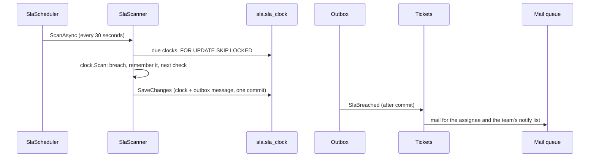

# Lesson 25 — Breaches: The Scheduler That Warns and Escalates

Good day, developer! A deadline that nobody watches is a number in a table. Today somebody starts watching. When a ticket's response or resolve target enters its last quarter, the person who has the ticket gets a warning. When it runs out, the assignee and the team's leads hear about it, once. And it all survives a restart, because a deadline is a row, not a timer. At the end we use the same machinery for something smaller and just as useful: telling the people who review knowledge base articles when one is waiting. It takes about three hours. Are you ready? Let's begin!

## What we'll build

| Piece | What it is |
|---|---|
| **A clock that remembers** | Each target records when it was warned and when it was breached, once, and the clock knows its next check time |
| **A scanner** | One pass: find the clocks whose check time has come, lock them, let each one warn or breach, save |
| **A scheduler** | A background service that runs the scanner every 30 seconds, and survives a failed pass |
| **Mail** | Tickets turns the two new events into email for the assignee and the team |
| **Review mail** | Submitting an article tells the KbEditors; sending it back or publishing it tells the author |

## Why we build it this way

### The pain: a timer per deadline

The first idea is a timer for each ticket: when it is created, start a timer for its due time, and when the timer fires, announce the breach. It reads well and it is wrong in three ways. A restart loses every timer, and with them every breach that was coming. A timer cannot be moved when the calendar changes, so the one that was set for Friday 17:00 still fires on the holiday it was moved from. And two copies of the app would each fire it.

### The fix: deadlines are rows, and a scanner reads them

Every clock already stores its due times (lesson 24). So we add one more column: **the next moment anything needs doing for this clock**, a warning or a breach. A scanner looks for clocks whose next check time has come, does the work, and moves the column forward. Nothing lives only in memory. A restart changes nothing, because the next pass finds whatever is due. A calendar change moves due times, and the next recalculation moves the check time with it.

Two rules keep it honest. Each warning and each breach happens **once per target**, and the clock remembers that it did. And the rows being worked on are **locked** while a scanner holds them, so two scanners never take the same clock.

### Now, let's be honest about the cost here

A scanner that wakes every 30 seconds means a breach is announced up to 30 seconds late, never early. For a deadline measured in hours that is fine, and it is the price of having no timers. Second, "once per target" is a decision with a downside: if a policy edit moves a deadline later after a warning went out, nobody is warned a second time. We think a second warning for the same ticket would be noise, but it is a choice.

## 1. A clock that remembers

The clock gains four timestamps (when each target was warned and breached) and one nullable column, `NextCheckUtc`. A clock with nothing running, or one that is paused, has no next check:

```csharp
// src/Modules/Sla/Yasda.Modules.Sla.Contracts/SlaWarnings.cs
using Yasda.Shared.BuildingBlocks;

namespace Yasda.Modules.Sla.Contracts;

// A target is entering its last quarter, and nobody has met it yet. Sent once per target. Target is "Response" or "Resolve".
public sealed record SlaBreachImminent(long TicketId, string Target, DateTime DueUtc) : IIntegrationEvent;

// A target's due time has passed without it being met. Sent once per target.
public sealed record SlaBreached(long TicketId, string Target, DateTime DueUtc) : IIntegrationEvent;
```

Those are the two public events: a target is entering its last quarter, and a target ran out of time. They carry the ticket's number, which target, and its due time. Now the domain side. The clock raises its own events, in its own words:

```csharp
// src/Modules/Sla/Yasda.Modules.Sla/Domain/SlaEvents.cs (added)
// Which of a ticket's two deadlines an event is about.
internal enum SlaTarget
{
    Response,
    Resolve,
}

// A target entered its last quarter, or ran out of time. Each is raised once per target, whatever happens to the clock afterwards.
internal sealed record SlaBreachImminentEvent(TicketId TicketId, SlaTarget Target, DateTime DueUtc) : IDomainEvent;

internal sealed record SlaBreachedEvent(TicketId TicketId, SlaTarget Target, DateTime DueUtc) : IDomainEvent;
```

And here are the new fields and the one new question the clock answers, `Scan`:

```csharp
// src/Modules/Sla/Yasda.Modules.Sla/Domain/SlaClock.cs (added)
    // Each warning and each breach is raised once per target and remembered, so a restart or a second scheduler never repeats it.
    public DateTime? ResponseWarnedUtc { get; private set; }
    public DateTime? ResponseBreachedUtc { get; private set; }
    public DateTime? ResolveWarnedUtc { get; private set; }
    public DateTime? ResolveBreachedUtc { get; private set; }

    // The next moment the scheduler has something to do for this clock: a warning to send or a breach to announce. null when
    // nothing is running, or while paused. The scheduler looks for clocks whose NextCheckUtc has come.
    public DateTime? NextCheckUtc { get; private set; }
```

```csharp
// src/Modules/Sla/Yasda.Modules.Sla/Domain/SlaClock.cs (added)
    // The scheduler asks each clock that is due a check: has a target run out of time, or entered its last quarter? Warned and
    // breached are remembered, so asking again changes nothing. A target that is already past due is breached, not warned.
    public void Scan(DateTime nowUtc)
    {
        nowUtc = WholeMicroseconds(nowUtc);
        if (Cancelled || IsPaused) return;

        if (RespondedUtc is null)
        {
            if (ResponseBreachedUtc is null && nowUtc > ResponseDueUtc)
            {
                ResponseBreachedUtc = nowUtc;
                Raise(new SlaBreachedEvent(Id, SlaTarget.Response, ResponseDueUtc));
            }
            else if (ResponseBreachedUtc is null && ResponseWarnedUtc is null && nowUtc >= ResponseAtRiskUtc)
            {
                ResponseWarnedUtc = nowUtc;
                Raise(new SlaBreachImminentEvent(Id, SlaTarget.Response, ResponseDueUtc));
            }
        }

        if (ResolvedUtc is null)
        {
            if (ResolveBreachedUtc is null && nowUtc > ResolveDueUtc)
            {
                ResolveBreachedUtc = nowUtc;
                Raise(new SlaBreachedEvent(Id, SlaTarget.Resolve, ResolveDueUtc));
            }
            else if (ResolveBreachedUtc is null && ResolveWarnedUtc is null && nowUtc >= ResolveAtRiskUtc)
            {
                ResolveWarnedUtc = nowUtc;
                Raise(new SlaBreachImminentEvent(Id, SlaTarget.Resolve, ResolveDueUtc));
            }
        }

        UpdateNextCheck();
    }

    private void UpdateNextCheck()
    {
        NextCheckUtc = null;
        if (Cancelled || IsPaused) return;

        if (RespondedUtc is null) NextCheckUtc = Earliest(NextCheckUtc, NextActionOf(ResponseWarnedUtc, ResponseBreachedUtc, ResponseAtRiskUtc, ResponseDueUtc));
        if (ResolvedUtc is null) NextCheckUtc = Earliest(NextCheckUtc, NextActionOf(ResolveWarnedUtc, ResolveBreachedUtc, ResolveAtRiskUtc, ResolveDueUtc));
    }

    // For one running target: when the next warning or breach is due, or null when both have been sent.
    private static DateTime? NextActionOf(DateTime? warnedUtc, DateTime? breachedUtc, DateTime atRiskUtc, DateTime dueUtc)
    {
        if (breachedUtc is not null) return null;
        if (warnedUtc is null) return atRiskUtc;
        return dueUtc;
    }

    private static DateTime? Earliest(DateTime? first, DateTime? second)
    {
        if (first is null) return second;
        if (second is null) return first;
        if (first < second) return first;
        return second;
    }

    private void Changed()
    {
        UpdateNextCheck();
        Version++;
        Raise(new DeadlinesChangedEvent(Id, Version, ResponseDueUtc, ResponseMet, ResolveDueUtc, ResolutionMet,
            NextDueUtc, AtRiskFromUtc, IsPaused));
    }
}
```

Read `Scan` slowly, because it carries the rules:

- A target that is **already late** is breached, not warned. If the app was down for a day, nobody needs a warning for a deadline that has passed.
- A breach needs `now > due`, not `>=`. A reply made at exactly the due time is on time (lesson 22), so a breach at that instant would be wrong.
- Warned and breached are remembered, so asking again changes nothing.
- The last line, `UpdateNextCheck`, decides the next moment. For each running target it is the warning time while no warning was sent, then the due time while no breach was announced, then nothing. The clock's next check is the earlier of its two targets'.

`Changed()` (the method every other change calls) now calls `UpdateNextCheck` too, so a recalculation, a pause or a resume moves the check time along with the deadlines.

## 2. The migration, and the old rows

The model has five new columns and one new index. The index is a **filtered index**, only on rows with a check time, because the scanner only ever asks about those, and most finished clocks have none:

```csharp
// src/Modules/Sla/Yasda.Modules.Sla/Infrastructure/SlaDbContext.cs (added)
            // The scheduler finds the clocks whose check time has come: only running clocks have one.
            e.HasIndex(x => x.NextCheckUtc).HasFilter("next_check_utc IS NOT NULL");
```

```bash
dotnet ef migrations add AddBreachScheduling --project src/Modules/Sla/Yasda.Modules.Sla --output-dir Infrastructure/Migrations
```

Once more, old rows. A clock that is running today has no check time, so the scheduler would never look at it until something else changed it. The migration gives each running clock its first check: the moment its next target enters its last quarter.

```csharp
// src/Modules/Sla/Yasda.Modules.Sla/Infrastructure/Migrations/<timestamp>_AddBreachScheduling.cs (the file EF Core made; replace its content)
using System;
using Microsoft.EntityFrameworkCore.Migrations;

#nullable disable

namespace Yasda.Modules.Sla.Infrastructure.Migrations
{
    /// <inheritdoc />
    public partial class AddBreachScheduling : Migration
    {
        /// <inheritdoc />
        protected override void Up(MigrationBuilder migrationBuilder)
        {
            migrationBuilder.AddColumn<DateTime>(
                name: "next_check_utc",
                schema: "sla",
                table: "sla_clock",
                type: "timestamp with time zone",
                nullable: true);

            migrationBuilder.AddColumn<DateTime>(
                name: "resolve_breached_utc",
                schema: "sla",
                table: "sla_clock",
                type: "timestamp with time zone",
                nullable: true);

            migrationBuilder.AddColumn<DateTime>(
                name: "resolve_warned_utc",
                schema: "sla",
                table: "sla_clock",
                type: "timestamp with time zone",
                nullable: true);

            migrationBuilder.AddColumn<DateTime>(
                name: "response_breached_utc",
                schema: "sla",
                table: "sla_clock",
                type: "timestamp with time zone",
                nullable: true);

            migrationBuilder.AddColumn<DateTime>(
                name: "response_warned_utc",
                schema: "sla",
                table: "sla_clock",
                type: "timestamp with time zone",
                nullable: true);

            migrationBuilder.CreateIndex(
                name: "ix_sla_clock_next_check_utc",
                schema: "sla",
                table: "sla_clock",
                column: "next_check_utc",
                filter: "next_check_utc IS NOT NULL");

            // The clocks that are running already get their first check time: the moment their next target enters its last quarter.
            // Without it the scheduler would never look at them until something else changed them.
            migrationBuilder.Sql(
                """
                UPDATE sla.sla_clock
                SET next_check_utc = CASE
                        WHEN responded_utc IS NULL THEN response_at_risk_utc
                        WHEN resolved_utc IS NULL THEN resolve_at_risk_utc
                    END
                WHERE NOT cancelled AND paused_since_utc IS NULL;
                """);
        }

        /// <inheritdoc />
        protected override void Down(MigrationBuilder migrationBuilder)
        {
            migrationBuilder.DropIndex(
                name: "ix_sla_clock_next_check_utc",
                schema: "sla",
                table: "sla_clock");

            migrationBuilder.DropColumn(
                name: "next_check_utc",
                schema: "sla",
                table: "sla_clock");

            migrationBuilder.DropColumn(
                name: "resolve_breached_utc",
                schema: "sla",
                table: "sla_clock");

            migrationBuilder.DropColumn(
                name: "resolve_warned_utc",
                schema: "sla",
                table: "sla_clock");

            migrationBuilder.DropColumn(
                name: "response_breached_utc",
                schema: "sla",
                table: "sla_clock");

            migrationBuilder.DropColumn(
                name: "response_warned_utc",
                schema: "sla",
                table: "sla_clock");
        }
    }
}
```

## 3. One pass: the scanner

The scanner is a class with one method. Notice what it does, in this order: it starts a transaction, asks for the clocks that are due *and locks them*, lets each one scan, saves, and commits.

```csharp
// src/Modules/Sla/Yasda.Modules.Sla/Features/Scheduler/SlaScanner.cs
using Yasda.Modules.Sla.Infrastructure;
using Microsoft.EntityFrameworkCore;

namespace Yasda.Modules.Sla.Features;

// One pass of the breach scheduler: find the clocks whose check time has come, and let each one warn or breach. Deadlines are rows,
// not timers, so a restart loses nothing: the next pass finds whatever is due.
//
// The rows are locked while they are looked at (FOR UPDATE SKIP LOCKED), so two scanners running at once (a second server, or a pass
// that overlaps the next) never take the same clock. Each warning and breach is saved in the same step as its event, and the clock
// remembers it was sent, so nothing is raised twice. This is a write path, so it uses EF Core, not Dapper.
internal sealed class SlaScanner(SlaDbContext db, TimeProvider time)
{
    public const int BatchSize = 100;

    // How many clocks were checked. A full batch means there may be more.
    public async Task<int> ScanAsync(CancellationToken ct)
    {
        await using var transaction = await db.Database.BeginTransactionAsync(ct);

        var now = time.GetUtcNow().UtcDateTime;
        var due = await db.Clocks
            .FromSql($"SELECT *, xmin FROM sla.sla_clock WHERE next_check_utc <= {now} ORDER BY next_check_utc LIMIT {BatchSize} FOR UPDATE SKIP LOCKED")
            .ToListAsync(ct);

        foreach (var clock in due)
        {
            clock.Scan(now);
        }

        await db.SaveChangesAsync(ct);
        await transaction.CommitAsync(ct);
        db.ChangeTracker.Clear();
        return due.Count;
    }
}
```

`FOR UPDATE SKIP LOCKED` is the line that makes two scanners safe. `FOR UPDATE` locks the rows it returns for the rest of the transaction. `SKIP LOCKED` makes a second scanner skip the rows the first holds, instead of waiting for them. So when two passes overlap, each takes different clocks, or the second takes none. The events the clocks raise are written to the outbox in the same `SaveChanges`, as you learned in lesson 13, so a breach and its event are saved together or not at all.

This is a write path, so it uses EF Core, not Dapper. We write the query by hand with `FromSql` because EF Core has no way to say "skip locked". We select `xmin` as well: it is the row version EF Core checks on save, a system column that `SELECT *` does not return.

## 4. The scheduler

A background service wakes up, runs the scanner, and sleeps. It takes the interval from configuration, because how often to poll is a property of an installation. Note `Task.Delay(interval, time, ...)`: the delay uses the `TimeProvider`, so a test could move time:

```csharp
// src/Modules/Sla/Yasda.Modules.Sla/Features/Scheduler/SlaScheduler.cs
using Yasda.Shared.BuildingBlocks;
using Microsoft.Extensions.Configuration;
using Microsoft.Extensions.DependencyInjection;
using Microsoft.Extensions.Hosting;
using Microsoft.Extensions.Logging;

namespace Yasda.Modules.Sla.Features;

// Wakes up every Sla:SchedulerSeconds (30 unless the installation says otherwise) and runs the scanner until it has nothing left to do.
// A pass that fails is logged and tried again at the next wake-up: one bad moment must not end the scheduler.
internal sealed class SlaScheduler(IServiceScopeFactory scopes, TimeProvider time, IConfiguration config, ILogger<SlaScheduler> log) : BackgroundService
{
    protected override async Task ExecuteAsync(CancellationToken stoppingToken)
    {
        var interval = TimeSpan.FromSeconds(config.GetValue("Sla:SchedulerSeconds", 30));

        while (!stoppingToken.IsCancellationRequested)
        {
            try
            {
                await Task.Delay(interval, time, stoppingToken);
            }
            catch (OperationCanceledException)
            {
                return;
            }

            try
            {
                await ScanUntilQuietAsync(stoppingToken);
            }
            catch (Exception ex) when (ex is not OperationCanceledException)
            {
                log.LogError(ex, "The SLA scheduler could not finish a pass; it will try again in {Seconds} seconds", interval.TotalSeconds);
            }
        }
    }

    private async Task ScanUntilQuietAsync(CancellationToken ct)
    {
        while (true)
        {
            // A new scope for each pass: a DbContext is meant to live for one unit of work.
            await using var scope = scopes.CreateAsyncScope();
            var scanner = scope.ServiceProvider.GetRequiredService<SlaScanner>();
            var checkedClocks = await scanner.ScanAsync(ct);
            if (checkedClocks < SlaScanner.BatchSize) return;
        }
    }
}
```

Two details. A pass that throws is logged and tried again at the next wake-up, because one bad moment (a database restart) must not end the scheduler for good. And a full batch (100 clocks) means there may be more, so it scans again at once. A new scope for each pass, because a `DbContext` is meant to live for one unit of work.

Register both, and say how often it runs:

```csharp
// src/Modules/Sla/Yasda.Modules.Sla/SlaModule.cs (added)
        services.AddScoped<IDomainEventHandler<SlaBreachImminentEvent>, PublishSlaBreachImminent>();
        services.AddScoped<IDomainEventHandler<SlaBreachedEvent>, PublishSlaBreached>();

        // The breach scheduler: warnings and breaches are found by polling the clocks' check times.
        services.AddScoped<SlaScanner>();
        services.AddHostedService<SlaScheduler>();
```

```json
// src/Yasda.Api/appsettings.json (added, next to the other sections)
  "Sla": {
    "SchedulerSeconds": 30
  },
```

The domain events become public ones, with the two small publishers you know:

```csharp
// src/Modules/Sla/Yasda.Modules.Sla/Features/Events/PublishDeadlinesChanged.cs (added)
// What the scheduler found, told to the other modules (Tickets mails the people who need to know). Each is raised once per target.
internal sealed class PublishSlaBreachImminent(IIntegrationEventPublisher publisher) : IDomainEventHandler<SlaBreachImminentEvent>
{
    public async Task HandleAsync(SlaBreachImminentEvent domainEvent, CancellationToken ct)
    {
        await publisher.PublishAsync(new SlaBreachImminent(domainEvent.TicketId.Value, domainEvent.Target.ToString(), domainEvent.DueUtc), ct);
    }
}

internal sealed class PublishSlaBreached(IIntegrationEventPublisher publisher) : IDomainEventHandler<SlaBreachedEvent>
{
    public async Task HandleAsync(SlaBreachedEvent domainEvent, CancellationToken ct)
    {
        await publisher.PublishAsync(new SlaBreached(domainEvent.TicketId.Value, domainEvent.Target.ToString(), domainEvent.DueUtc), ct);
    }
}
```

## 5. Mail about a deadline

Sla does not know who has a ticket, or which team it belongs to. Tickets does. So Tickets listens to Sla's two events, looks the ticket up, and queues the mail, the same way it mails about a new reply:

```csharp
// src/Modules/Tickets/Yasda.Modules.Tickets/Features/Events/EmailOnSlaEvents.cs
using Dapper;
using Microsoft.Extensions.Configuration;
using Yasda.Modules.Identity.Contracts;
using Yasda.Modules.Sla.Contracts;
using Yasda.Modules.Tickets.Domain;
using Yasda.Shared.BuildingBlocks;

namespace Yasda.Modules.Tickets.Features;

// Mail about a deadline, sent when Sla's scheduler announces it. Like the other mail they only queue. Sla sends each warning and each
// breach once per target, and the key says which target (kind:ticket:target:person), so a redelivery queues nothing new.

internal sealed record DeadlineTicket(long Id, string Subject, long? AssigneeId, long? TeamId);

internal static class DeadlineMail
{
    // null when the ticket is gone (a deadline for a ticket that no longer exists is not worth failing the delivery for).
    public static async Task<DeadlineTicket?> FindTicketAsync(IDbConnectionFactory connections, long ticketId, CancellationToken ct)
    {
        await using var conn = connections.Create();
        return await conn.QuerySingleOrDefaultAsync<DeadlineTicket>(new CommandDefinition(
            "SELECT id, subject, assignee_id, team_id FROM tickets.get_ticket(@ticketId, NULL)", new { ticketId }, cancellationToken: ct));
    }

    public static string WhichDeadline(string target)
    {
        if (target == "Response") return "answer";
        return "resolution";
    }
}

// A target is in its last quarter: the person who has the ticket hears, or the team's notify list when nobody has it (decision D9).
internal sealed class EmailOnSlaWarning(IDbConnectionFactory connections, IMailQueue mail, ITeamDirectory teams, IConfiguration config)
    : IIntegrationEventHandler<SlaBreachImminent>
{
    public async Task HandleAsync(SlaBreachImminent integrationEvent, CancellationToken ct)
    {
        var ticket = await DeadlineMail.FindTicketAsync(connections, integrationEvent.TicketId, ct);
        if (ticket is null) return;

        var people = new List<long>();
        if (ticket.AssigneeId is not null) people.Add(ticket.AssigneeId.Value);
        else people.AddRange(await teams.NotifyListAsync(ticket.TeamId, ct));

        var subject = $"Ticket #{ticket.Id} is close to its {DeadlineMail.WhichDeadline(integrationEvent.Target)} deadline: {ticket.Subject}";
        var body = $"The {DeadlineMail.WhichDeadline(integrationEvent.Target)} deadline is {integrationEvent.DueUtc:yyyy-MM-dd HH:mm} UTC.\n\n{ticket.Subject}\n\nOpen it: {TicketMail.LinkTo(config, new TicketId(ticket.Id))}";
        foreach (var person in people)
        {
            await mail.QueueAsync($"sla-warning:{ticket.Id}:{integrationEvent.Target}:{person}", person, subject, body, ct);
        }
    }
}

// A target ran out of time: the person who has the ticket and the team's notify list (which always holds the team leads) hear.
internal sealed class EmailOnSlaBreach(IDbConnectionFactory connections, IMailQueue mail, ITeamDirectory teams, IConfiguration config)
    : IIntegrationEventHandler<SlaBreached>
{
    public async Task HandleAsync(SlaBreached integrationEvent, CancellationToken ct)
    {
        var ticket = await DeadlineMail.FindTicketAsync(connections, integrationEvent.TicketId, ct);
        if (ticket is null) return;

        var people = new List<long>();
        if (ticket.AssigneeId is not null) people.Add(ticket.AssigneeId.Value);
        foreach (var person in await teams.NotifyListAsync(ticket.TeamId, ct))
        {
            if (!people.Contains(person)) people.Add(person);
        }

        var subject = $"Ticket #{ticket.Id} missed its {DeadlineMail.WhichDeadline(integrationEvent.Target)} deadline: {ticket.Subject}";
        var body = $"The {DeadlineMail.WhichDeadline(integrationEvent.Target)} deadline was {integrationEvent.DueUtc:yyyy-MM-dd HH:mm} UTC.\n\n{ticket.Subject}\n\nOpen it: {TicketMail.LinkTo(config, new TicketId(ticket.Id))}";
        foreach (var person in people)
        {
            await mail.QueueAsync($"sla-breached:{ticket.Id}:{integrationEvent.Target}:{person}", person, subject, body, ct);
        }
    }
}
```

Two things to notice. The mail key names the kind, the ticket, the target and the person, so a redelivered event queues nothing new. And if the ticket is gone, the handler returns instead of throwing: a handler that throws makes the outbox deliver again, forever.

Register them next to the others in `AddTicketsModule`:

```csharp
// src/Modules/Tickets/Yasda.Modules.Tickets/TicketsModule.cs (added, in AddTicketsModule)
        services.AddScoped<IIntegrationEventHandler<SlaBreachImminent>, EmailOnSlaWarning>();
        services.AddScoped<IIntegrationEventHandler<SlaBreached>, EmailOnSlaBreach>();
```

## 6. Prove it: the scheduler

The clock's rules first, with no database. Monday 09:00 Manila, 4 open hours to respond: due at 13:00, at risk from 12:00:

```csharp
// tests/Yasda.Modules.Sla.UnitTests/SlaClockTests.cs (added)
    [Fact]
    public void Scanning_in_the_last_quarter_raises_one_warning_and_then_waits_for_the_due_time()
    {
        var clock = MondayMorningClock();

        clock.Scan(ManilaTime(11, 23, 12, 30));
        clock.Scan(ManilaTime(11, 23, 12, 31));

        var warning = clock.DomainEvents.Should().ContainSingle().Which.Should().BeOfType<SlaBreachImminentEvent>().Which;
        warning.Target.Should().Be(SlaTarget.Response);
        warning.DueUtc.Should().Be(ManilaTime(11, 23, 13));
        clock.NextCheckUtc.Should().Be(ManilaTime(11, 23, 13));
    }
```

```csharp
// tests/Yasda.Modules.Sla.UnitTests/SlaClockTests.cs (added)
    [Fact]
    public void Scanning_exactly_at_the_due_time_is_not_yet_a_breach()
    {
        var clock = MondayMorningClock();
        clock.Scan(ManilaTime(11, 23, 12, 30));
        clock.ClearEvents();

        clock.Scan(ManilaTime(11, 23, 13));

        clock.DomainEvents.Should().BeEmpty("an answer at exactly the due time is still on time");
    }
```

| Test | Why it matters |
|---|---|
| `A_new_clock_is_next_checked_when_its_response_target_enters_its_last_quarter` | The first check time is the warning time |
| `Scanning_before_the_last_quarter_raises_nothing` | Early scans are harmless |
| `Scanning_after_the_due_time_raises_one_breach_and_then_checks_the_resolve_target` | The response target is done with; the resolve target is next |
| `A_target_found_already_late_is_breached_without_a_warning_first` | After a long outage, no stale warnings |
| `A_met_target_is_never_announced_and_a_clock_with_nothing_running_has_no_check_time` | A met target cannot be breached |
| `A_paused_or_cancelled_clock_is_never_announced_and_has_no_check_time` | No time counts, so nothing is late |
| `Resuming_makes_the_clock_checkable_again_at_its_new_times` | A pause's end puts the clock back on the scanner's list |
| `A_warning_already_sent_is_not_sent_again_when_the_due_time_moves_later` | Once per target |

Now the scanner against a real database. Time cannot be moved forward, so each test files a real ticket and moves *its* deadlines into the past in the database, then runs the scanner itself:

```csharp
// tests/Yasda.Integration.Tests/SlaSchedulerTests.cs (the top of the new file; the tests below go inside the class)
using System.Net.Http.Json;
using AwesomeAssertions;
using Dapper;
using Microsoft.Extensions.DependencyInjection;
using Yasda.Modules.Sla.Features;

namespace Yasda.Integration.Tests;

// The breach scheduler: deadlines are rows, and a scanner finds the ones that have come. Each test makes its own ticket, then moves
// that ticket's deadlines into the past in the database (time can't be moved forward), and runs the scanner itself.
[Collection("Integration")]
public class SlaSchedulerTests(CustomWebAppFactory factory)
{
    private const string Requester = "requester@yasda.local", Agent = "agent@yasda.local";

    private sealed record Created(long Id);
    private sealed record Me(long Id);
    private sealed record Ticket(DeadlinesView? Sla);
    private sealed record DeadlinesView(bool Paused, bool? ResponseMet);
    private sealed record Clock(DateTime? ResponseWarnedUtc, DateTime? ResponseBreachedUtc, DateTime? NextCheckUtc);

    private async Task<(long TicketId, long AgentId)> FileTakenTicket()
    {
        var requester = await factory.ClientFor(Requester);
        var agent = await factory.ClientFor(Agent);
        var response = await requester.PostAsJsonAsync("/api/tickets", new { subject = $"Scheduler {Guid.NewGuid():N}", message = "Please help.", priority = "High" });
        var id = (await response.Content.ReadFromJsonAsync<Created>())!.Id;
        (await agent.PostAsync($"/api/tickets/{id}/take", null)).EnsureSuccessStatusCode();
        await Waiting.Eventually(() => agent.GetFromJsonAsync<Ticket>($"/api/tickets/{id}")!, t => t!.Sla is not null);
        var me = await agent.GetFromJsonAsync<Me>("/api/auth/me");
        return (id, me!.Id);
    }

    // Moves the response deadline: the warning point and the due time are given as hours from now (negative is the past).
    private async Task MoveResponseDeadline(long ticketId, double atRiskHours, double dueHours)
    {
        await using var conn = factory.OpenDatabase();
        await conn.ExecuteAsync(
            """
            UPDATE sla.sla_clock
            SET response_at_risk_utc = now() + make_interval(secs => @atRisk), response_due_utc = now() + make_interval(secs => @due),
                next_check_utc = CASE WHEN next_check_utc IS NULL THEN NULL ELSE now() + make_interval(secs => @atRisk) END
            WHERE ticket_id = @ticketId
            """, new { ticketId, atRisk = atRiskHours * 3600, due = dueHours * 3600 });
    }

    private async Task<int> ScanOnce()
    {
        await using var scope = factory.Services.CreateAsyncScope();
        return await scope.ServiceProvider.GetRequiredService<SlaScanner>().ScanAsync(CancellationToken.None);
    }

    private async Task<Clock> ClockOf(long ticketId)
    {
        await using var conn = factory.OpenDatabase();
        return await conn.QuerySingleAsync<Clock>(
            "SELECT response_warned_utc, response_breached_utc, next_check_utc FROM sla.sla_clock WHERE ticket_id = @ticketId", new { ticketId });
    }

    private async Task<List<string>> MailKeys(long ticketId, string kind)
    {
        await using var conn = factory.OpenDatabase();
        await Waiting.OutboxesAreDrainedAsync(conn);
        var keys = await conn.QueryAsync<string>("SELECT key FROM identity.outgoing_mail WHERE key LIKE @pattern ORDER BY key", new { pattern = $"{kind}:{ticketId}:%" });
        return keys.ToList();
    }
    // ... the tests that follow
```

```csharp
// tests/Yasda.Integration.Tests/SlaSchedulerTests.cs (added)
    [Fact]
    public async Task A_missed_target_is_announced_once_to_the_assignee_and_the_team_leads_however_often_the_scanner_runs()
    {
        var (ticketId, agentId) = await FileTakenTicket();
        await MoveResponseDeadline(ticketId, atRiskHours: -2, dueHours: -1);

        // Two passes after each other, then two at the same moment: the second finds nothing because the clock remembers, and
        // the rows being scanned are locked, so a scanner running alongside skips them.
        await ScanOnce();
        var firstBreach = (await ClockOf(ticketId)).ResponseBreachedUtc;
        await ScanOnce();
        await Task.WhenAll(ScanOnce(), ScanOnce());

        var clock = await ClockOf(ticketId);
        clock.ResponseBreachedUtc.Should().Be(firstBreach, "the breach is recorded once");
        clock.ResponseWarnedUtc.Should().BeNull("a target that is already late is breached, not warned");
        var keys = await MailKeys(ticketId, "sla-breached");
        keys.Should().OnlyHaveUniqueItems();
        keys.Should().Contain($"sla-breached:{ticketId}:Response:{agentId}");
        keys.Count.Should().BeGreaterThan(1, "the team leads hear as well as the assignee");
        (await MailKeys(ticketId, "sla-warning")).Should().BeEmpty();
    }
```

```csharp
// tests/Yasda.Integration.Tests/SlaSchedulerTests.cs (added)
    // A restart is a new scanner with no memory of the old one: what it knows is in the database.
    [Fact]
    public async Task A_restart_mid_breach_escalates_once()
    {
        var (ticketId, _) = await FileTakenTicket();
        await MoveResponseDeadline(ticketId, atRiskHours: -2, dueHours: -1);
        await ScanOnce();
        var keysBefore = await MailKeys(ticketId, "sla-breached");

        await using (var restarted = factory.WithWebHostBuilder(_ => { }))
        {
            await using var scope = restarted.Services.CreateAsyncScope();
            await scope.ServiceProvider.GetRequiredService<SlaScanner>().ScanAsync(CancellationToken.None);
        }

        (await MailKeys(ticketId, "sla-breached")).Should().Equal(keysBefore);
    }
```

| Test | Why it matters |
|---|---|
| `A_target_in_its_last_quarter_warns_the_assignee_once` | One warning, one mail, however often it runs |
| `A_ticket_waiting_on_the_requester_is_never_warned_or_breached` | A paused clock has no check time |
| `A_deadline_met_in_time_is_never_announced` | Replying in time ends the target's watch |

The test host's scheduler wakes only once an hour, so it never gets in the way of tests that run the scanner themselves. That is one setting, in the test factory:

```csharp
// tests/Yasda.Integration.Tests/CustomWebAppFactory.cs (added, with the other settings)
        builder.UseSetting("Sla:SchedulerSeconds", "3600");
```

### Make each one fail once

In `SlaScanner`, delete ` FOR UPDATE SKIP LOCKED` from the SQL and run `A_missed_target_is_announced_once_to_the_assignee_and_the_team_leads_however_often_the_scanner_runs`. Two scanners at once may now both take the clock; the clock's row version makes one fail with a concurrency error, which is the second wall behind the lock. Put it back. Then in `SlaClock.Scan`, change `nowUtc > ResponseDueUtc` to `>=`: `Scanning_exactly_at_the_due_time_is_not_yet_a_breach` fails. Put it back.

## 7. The same idea, smaller: mail for the review

The review you built in lesson 20 is silent. An agent submits an article and a KbEditor finds out only by opening the review list. We use what this lesson just built (events, the outbox, queued mail) to tell them.

Knowledge needs to know who the KbEditors are, and people belong to Identity. So Identity gets one more question it can answer. First the contract:

```csharp
// src/Modules/Identity/Yasda.Modules.Identity.Contracts/IdentityContracts.cs (added)
    // The active accounts that have this role (a name from Roles). Knowledge uses it to tell the editors an article is waiting.
    Task<IReadOnlyList<long>> UsersInRoleAsync(string role, CancellationToken ct);
```

Its answer is a SQL function, like every read, shipped by a migration:

```sql
-- src/Modules/Identity/Yasda.Modules.Identity/Infrastructure/Sql/Functions/identity.users_in_role.v1.sql
-- The active accounts that have a role, by name. Other modules ask for it through IUserDirectory.UsersInRoleAsync.
CREATE OR REPLACE FUNCTION identity.users_in_role(p_role text)
RETURNS TABLE (user_id bigint)
LANGUAGE sql STABLE
AS $$
    SELECT u.id
    FROM identity.users u
    JOIN identity.user_roles ur ON ur.user_id = u.id
    JOIN identity.roles r ON r.id = ur.role_id
    WHERE r.name = p_role AND NOT u.is_disabled
    ORDER BY u.id;
$$;
```

```csharp
// src/Modules/Identity/Yasda.Modules.Identity/Infrastructure/UserDirectory.cs (added)
    public async Task<IReadOnlyList<long>> UsersInRoleAsync(string role, CancellationToken ct)
    {
        await using var conn = connections.Create();
        var ids = await conn.QueryAsync<long>(new CommandDefinition(
            "SELECT user_id FROM identity.users_in_role(@role)", new { role }, cancellationToken: ct));
        return ids.ToList();
    }
```

```bash
dotnet ef migrations add AddUsersInRoleFunction --project src/Modules/Identity/Yasda.Modules.Identity --context YasdaIdentityDbContext --output-dir Infrastructure/Migrations
```

```csharp
// src/Modules/Identity/Yasda.Modules.Identity/Infrastructure/Migrations/<timestamp>_AddUsersInRoleFunction.cs (the file EF Core made; replace its content)
using Microsoft.EntityFrameworkCore.Migrations;
using Yasda.Shared.BuildingBlocks;

#nullable disable

namespace Yasda.Modules.Identity.Infrastructure.Migrations
{
    // Knowledge asks Identity who the KbEditors are. One more read-side SQL function, shipped like the others.
    public partial class AddUsersInRoleFunction : Migration
    {
        private static string Sql(string file)
        {
            return EmbeddedSql.Read(typeof(AddUsersInRoleFunction).Assembly, file);
        }

        protected override void Up(MigrationBuilder migrationBuilder)
        {
            migrationBuilder.Sql(Sql("identity.users_in_role.v1.sql"));
        }

        protected override void Down(MigrationBuilder migrationBuilder)
        {
            migrationBuilder.Sql("DROP FUNCTION IF EXISTS identity.users_in_role(text);");
        }
    }
}
```

Now the article. A review step that somebody must hear about raises an event, in Knowledge's own words. Each carries an id, because the mail is keyed by it:

```csharp
// src/Modules/Knowledge/Yasda.Modules.Knowledge/Domain/ArticleEvents.cs
using Yasda.Shared.BuildingBlocks;

namespace Yasda.Modules.Knowledge.Domain;

// Steps of the review that somebody must hear about, in Knowledge's own words. Each is saved to the outbox in the same save as the
// step, then delivered after the commit; the mail handlers turn them into mail. EventId names this one happening: mail is keyed
// by it, so a redelivered event queues each mail once.
internal sealed record ArticleSubmittedEvent(Guid EventId, ArticleId ArticleId, string Title, UserId SubmittedById) : IDomainEvent;

internal sealed record ArticleRejectedEvent(Guid EventId, ArticleId ArticleId, string Title, UserId AuthorId, UserId RejectedById, string Reason) : IDomainEvent;

internal sealed record ArticlePublishedEvent(Guid EventId, ArticleId ArticleId, string Title, UserId AuthorId, UserId PublishedById, int VersionNumber) : IDomainEvent;
```

The three methods of `Article` that matter raise them, in the same step as the change:

```csharp
// src/Modules/Knowledge/Yasda.Modules.Knowledge/Domain/Article.cs (added)
    // The author is done and asks for a review.
    public void Submit(Person actor, ArticleAccess access, DateTime nowUtc)
    {
        EnsureNotArchived();
        EnsureMayEdit(actor, access);
        EnsureIn("submit", ArticleStatus.Draft);

        Status = ArticleStatus.InReview;
        RejectionReason = null;
        UpdatedUtc = nowUtc;
        Record(ArticleAction.Submitted, actor, nowUtc);
        Raise(new ArticleSubmittedEvent(Guid.NewGuid(), Id, Title, actor.Id));
    }
```

```csharp
// src/Modules/Knowledge/Yasda.Modules.Knowledge/Domain/Article.cs (added)
    // A reviewer sends it back to the author, and says why.
    public void Reject(string reason, Person actor, DateTime nowUtc)
    {
        EnsureNotArchived();
        EnsureIn("send back", ArticleStatus.InReview);
        var text = CheckedReason(reason);

        Status = ArticleStatus.Draft;
        RejectionReason = text;
        UpdatedUtc = nowUtc;
        Record(ArticleAction.Rejected, actor, nowUtc, note: text);
        Raise(new ArticleRejectedEvent(Guid.NewGuid(), Id, Title, CreatedById, actor.Id, text));
    }
```

```csharp
// src/Modules/Knowledge/Yasda.Modules.Knowledge/Domain/Article.cs (added)
        Record(ArticleAction.Published, actor, nowUtc, versionNumber: CurrentVersion);
        Raise(new ArticlePublishedEvent(Guid.NewGuid(), Id, Title, CreatedById, actor.Id, CurrentVersion));
    }
```

And the three mail handlers. Nobody is mailed about their own step, and an installation with no KbEditor has only its Admins to publish, so they hear instead:

```csharp
// src/Modules/Knowledge/Yasda.Modules.Knowledge/Features/ChangeArticleStatus/EmailOnArticleReview.cs
using Microsoft.Extensions.Configuration;
using Yasda.Modules.Identity.Contracts;
using Yasda.Modules.Knowledge.Domain;
using Yasda.Shared.BuildingBlocks;

namespace Yasda.Modules.Knowledge.Features;

// Mail about the review (decision E9). These run in the outbox delivery, so they only queue: Identity's background service sends.
// The key of each mail is "kind:eventId:userId", so a redelivered event queues each mail once. Nobody gets mail about their own action.

internal static class ArticleMail
{
    // Where the article can be opened. App:PublicUrl is an installation setting.
    public static string BaseUrl(IConfiguration config)
    {
        return (config["App:PublicUrl"] ?? "").TrimEnd('/');
    }
}

// Someone sent an article for review: the KbEditors hear. An installation with no KbEditor has only its Admins to publish, so they hear.
internal sealed class EmailOnArticleSubmitted(IMailQueue mail, IUserDirectory users, IConfiguration config) : IDomainEventHandler<ArticleSubmittedEvent>
{
    public async Task HandleAsync(ArticleSubmittedEvent domainEvent, CancellationToken ct)
    {
        var reviewers = await users.UsersInRoleAsync(Roles.KbEditor, ct);
        if (reviewers.Count == 0) reviewers = await users.UsersInRoleAsync(Roles.Admin, ct);

        var subject = $"Article waiting for review: {domainEvent.Title}";
        var body = $"{domainEvent.Title}\n\nIt needs a review before readers can see it.\n\nOpen it: {ArticleMail.BaseUrl(config)}/kb/manage/{domainEvent.ArticleId.Value}";
        foreach (var person in reviewers)
        {
            if (person == domainEvent.SubmittedById.Value) continue;
            await mail.QueueAsync($"article-submitted:{domainEvent.EventId}:{person}", person, subject, body, ct);
        }
    }
}

// A reviewer sent the article back: the author hears why.
internal sealed class EmailOnArticleRejected(IMailQueue mail, IConfiguration config) : IDomainEventHandler<ArticleRejectedEvent>
{
    public async Task HandleAsync(ArticleRejectedEvent domainEvent, CancellationToken ct)
    {
        if (domainEvent.AuthorId == domainEvent.RejectedById) return;

        var subject = $"Your article was sent back: {domainEvent.Title}";
        var body = $"{domainEvent.Title}\n\nWhy: {domainEvent.Reason}\n\nChange it and send it again: {ArticleMail.BaseUrl(config)}/kb/manage/{domainEvent.ArticleId.Value}";
        var author = domainEvent.AuthorId.Value;
        await mail.QueueAsync($"article-rejected:{domainEvent.EventId}:{author}", author, subject, body, ct);
    }
}

// A reviewer published the article: the author hears it is live.
internal sealed class EmailOnArticlePublished(IMailQueue mail, IConfiguration config) : IDomainEventHandler<ArticlePublishedEvent>
{
    public async Task HandleAsync(ArticlePublishedEvent domainEvent, CancellationToken ct)
    {
        if (domainEvent.AuthorId == domainEvent.PublishedById) return;

        var subject = $"Your article is published: {domainEvent.Title}";
        var body = $"{domainEvent.Title}\n\nVersion {domainEvent.VersionNumber} is what readers see now.\n\nOpen it: {ArticleMail.BaseUrl(config)}/kb/{domainEvent.ArticleId.Value}";
        var author = domainEvent.AuthorId.Value;
        await mail.QueueAsync($"article-published:{domainEvent.EventId}:{author}", author, subject, body, ct);
    }
}
```

Register them in `AddKnowledgeModule`:

```csharp
// src/Modules/Knowledge/Yasda.Modules.Knowledge/KnowledgeModule.cs (added)
        // Event handlers are registered by the interface they answer to (the outbox looks them up that way).
        services.AddScoped<IDomainEventHandler<ArticleSubmittedEvent>, EmailOnArticleSubmitted>();
        services.AddScoped<IDomainEventHandler<ArticleRejectedEvent>, EmailOnArticleRejected>();
        services.AddScoped<IDomainEventHandler<ArticlePublishedEvent>, EmailOnArticlePublished>();
```

The round-trip test that survives the outbox needs the new events. Add them to its list, as lesson 13 taught: in `OutboxTests`, a `KnowledgeDomain` alias, one example of each event, and the three types in the "no event is left out" set.

## 8. Prove it: the review sends mail

```csharp
// tests/Yasda.Integration.Tests/KnowledgeMailTests.cs (the top of the new file; the tests below go inside the class)
using System.Net.Http.Json;
using AwesomeAssertions;
using Dapper;
using Microsoft.Extensions.DependencyInjection;
using Yasda.Modules.Identity.Contracts;
using Yasda.Shared.BuildingBlocks;
using static Yasda.Integration.Tests.KnowledgeApi;

namespace Yasda.Integration.Tests;

// Decision E9: the review sends mail. Submitting tells the KbEditors, and sending back or publishing tells the author. The tests read
// identity.outgoing_mail once the outbox has delivered, and find each article's mail by its title.
[Collection("Integration")]
public class KnowledgeMailTests(CustomWebAppFactory factory)
{
    private const string Agent = "agent@yasda.local", KbEditor = "editor@yasda.local";

    private async Task<List<string>> RecipientsOfMailAbout(string title, string subjectStart)
    {
        await using var conn = factory.OpenDatabase();
        await Waiting.OutboxesAreDrainedAsync(conn);
        var addresses = await conn.QueryAsync<string>(
            "SELECT to_address FROM identity.outgoing_mail WHERE subject = @subject ORDER BY to_address", new { subject = $"{subjectStart}: {title}" });
        return addresses.ToList();
    }
    // ... the tests that follow
```

```csharp
// tests/Yasda.Integration.Tests/KnowledgeMailTests.cs (added)
    [Fact]
    public async Task Submitting_an_article_mails_the_kb_editors_and_not_the_author()
    {
        var agent = await factory.ClientFor(Agent);
        var title = UniqueTitle("Mail submit");
        var id = await CreateAsync(agent, title);

        (await StepAsync(agent, id, "submit")).EnsureSuccessStatusCode();

        var recipients = await RecipientsOfMailAbout(title, "Article waiting for review");
        recipients.Should().Contain(KbEditor);
        recipients.Should().NotContain(Agent);
        recipients.Should().OnlyHaveUniqueItems();
    }
```

| Test | Why it matters |
|---|---|
| `Sending_an_article_back_mails_the_author_with_the_reason` | The reason travels in the mail |
| `Publishing_an_article_mails_the_author_once` | One mail for one publication |
| `Nobody_is_mailed_about_their_own_review_step` | An Admin who submits and publishes their own draft hears nothing |
| `The_directory_lists_the_active_accounts_of_a_role` | Identity's new answer |

And in the article's own tests, with no database:

```csharp
// tests/Yasda.Modules.Knowledge.UnitTests/ArticleLifeTests.cs (added)
    [Fact]
    public void Submitting_rejecting_and_publishing_each_raise_the_event_somebody_must_hear_about()
    {
        var article = NewDraft();
        article.ClearEvents();

        article.Submit(Author, Nothing, Now);
        article.Reject("Add a screenshot", Kira, Now);
        article.Submit(Author, Nothing, Now);
        article.Publish(Kira, actorIsAdmin: false, Now);

        article.DomainEvents.Should().HaveCount(4);
        article.DomainEvents[0].Should().BeOfType<ArticleSubmittedEvent>().Which.SubmittedById.Should().Be(Author.Id);
        var rejected = article.DomainEvents[1].Should().BeOfType<ArticleRejectedEvent>().Which;
        rejected.AuthorId.Should().Be(Author.Id);
        rejected.RejectedById.Should().Be(Kira.Id);
        rejected.Reason.Should().Be("Add a screenshot");
        var published = article.DomainEvents[3].Should().BeOfType<ArticlePublishedEvent>().Which;
        published.VersionNumber.Should().Be(1);
        published.PublishedById.Should().Be(Kira.Id);
    }
```

## How a request flows

A deadline passes, and the scheduler finds it:



## Mistakes to avoid

- Keeping deadlines in timers. They die with the process and cannot follow the calendar.
- Scanning without locking the rows. Two scanners would raise the same breach twice.
- Warning and breaching in the same pass for a target that is already late.
- Raising an event and marking the clock in two saves. A crash between them repeats or loses the event.
- Letting an event handler throw for a ticket that no longer exists. The outbox would deliver it again forever.
- Reading a breach as `>=`. A reply at exactly the due time is on time.
- Giving a paused clock a check time. Nothing counts, so nothing can be late.

## Let's run it!

```bash
dotnet build Yasda.slnx
dotnet test --solution Yasda.slnx
dotnet run --project src/Yasda.Api
```

The tests should end with no failures. To watch the scheduler work, file a ticket with priority Critical (1 hour to respond) as `requester@yasda.local`, then in `psql` move its deadline into the past:

```sql
UPDATE sla.sla_clock SET response_due_utc = now() - interval '1 hour', response_at_risk_utc = now() - interval '2 hours',
       next_check_utc = now() - interval '2 hours' WHERE ticket_id = (SELECT max(ticket_id) FROM sla.sla_clock);
```

Within 30 seconds the app's log says the mail was queued for the assignee and the team, and the ticket's SLA column, in the queue, says it is breached. Run the same `UPDATE` again: nothing new is queued.

## Let's check!

1. Why are deadlines rows and not timers, and what does the scanner read?
2. What do `FOR UPDATE` and `SKIP LOCKED` each do, and what goes wrong without them?
3. Why is a target that is already late breached and not warned?
4. Why is a breach `now > due` and not `>=`?
5. Why are the clock's change and its event saved in the same `SaveChanges`?
6. Why does Tickets, and not Sla, send the mail about a deadline?
7. Why does the mail handler return when the ticket is gone, instead of throwing?
8. What does the migration do for clocks that are already running, and why?
9. Why does `Task.Delay` take the `TimeProvider`?
10. Who is told when an article is submitted for review, and who is not?

And that's where this lesson ends. Deadlines are watched, warnings and breaches are announced once, and a restart changes nothing. Next time, we hand some of the routine work to the system itself: rules an Admin can switch on to close old tickets and remind silent requesters, and a different SLA for a category that needs one. Good luck, developer!

---

← [Lesson 24 — Deadlines in open hours, and the pause](24-clocks.md) · Next: [Lesson 26 — Automatic rules and category SLAs](26-rules.md) →
